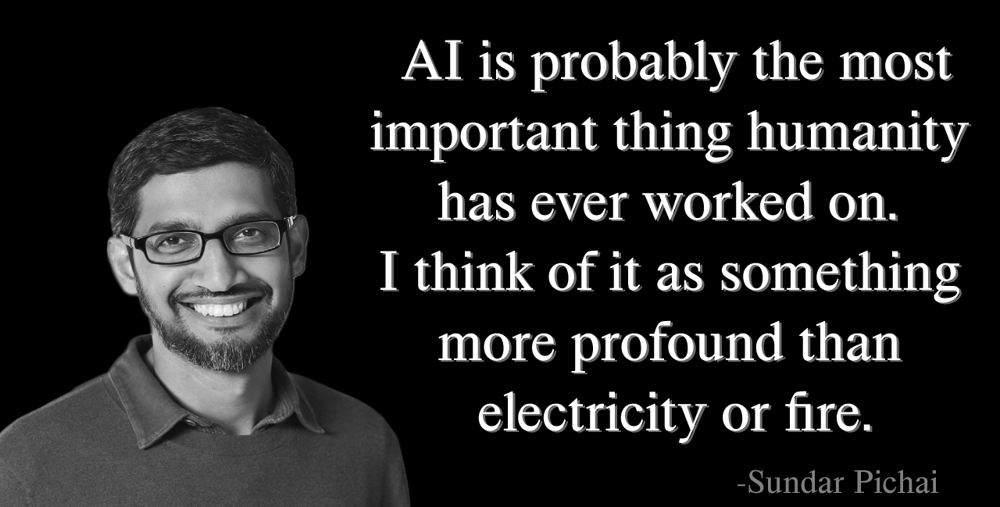
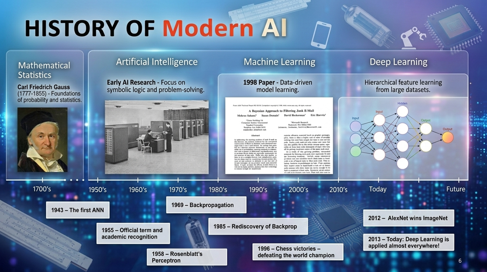
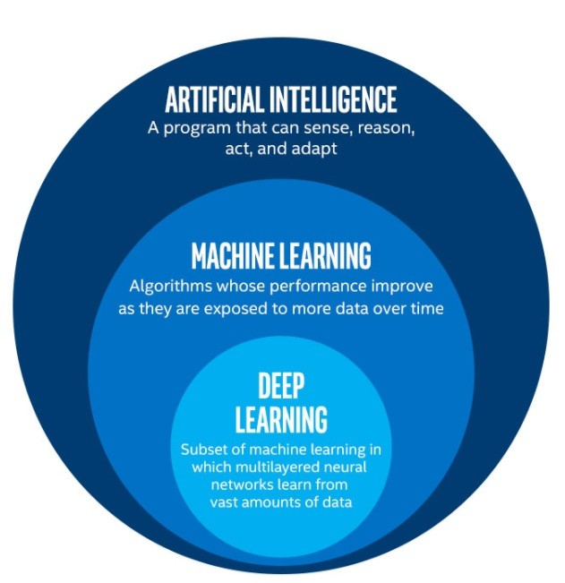
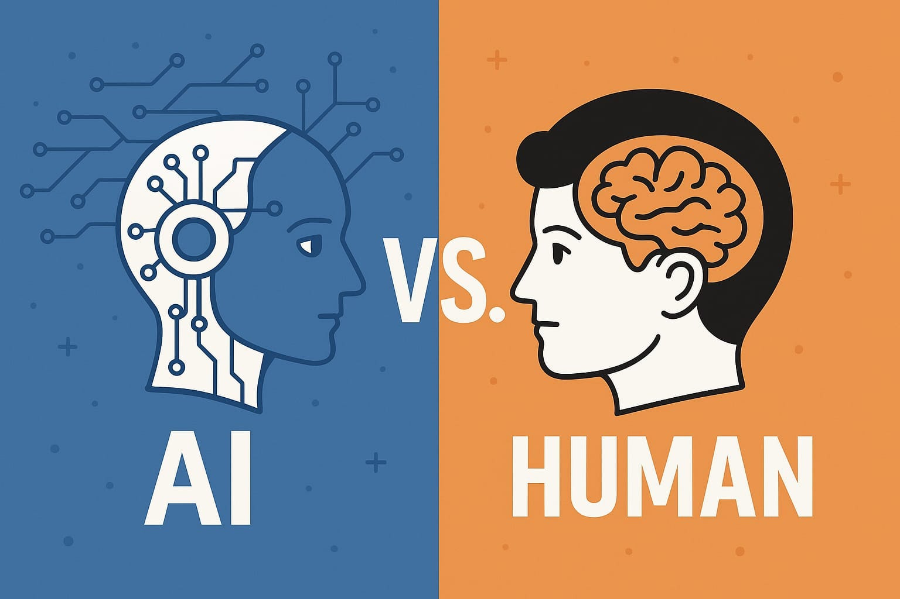
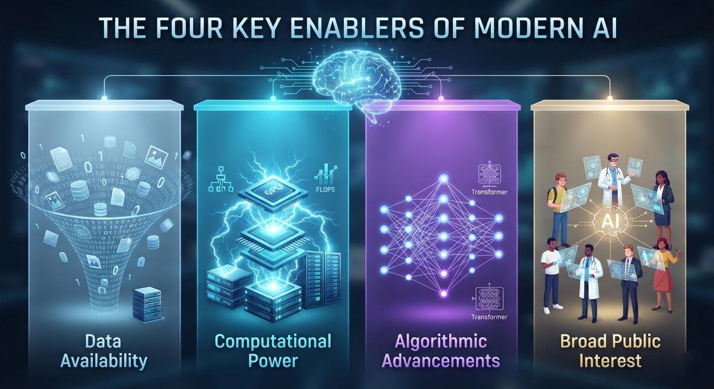
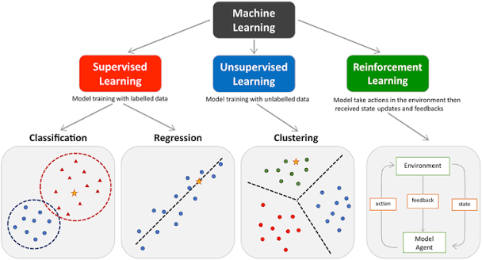

# What is Machine Learning & AI?

Every time you unlock your phone with your face, get a movie recommendation that's a little too accurate, or ask a voice assistant a question, you're interacting with artificial intelligence.      
But here's something that trips up almost every beginner: the terms "`AI`" and "`machine learning`" get used interchangeably online, when they actually mean different things. Getting this straight now will save you a lot of confusion later in this series, so let's clear it up.

## Let's start with Artificial Intelligence.

AI is the broadest term of the three. At its core, it's the general field of building machines that can perform tasks that would normally require human intelligence - things like understanding language, recognizing images, making decisions, or solving problems. AI is the goal. It's the umbrella that covers everything from a simple chess-playing program with hand-coded rules, all the way to a self-driving car navigating a busy street.

Notice I said "`hand-coded rules.`" That's important, because AI doesn't have to involve learning at all. Early AI systems were often just huge sets of if-this-then-that rules written by programmers. That approach works for simple, well-defined problems, but it falls apart fast when the real world gets messy and unpredictable - which is most of the time.

## History of modern AI

## That's where Machine Learning comes in.

Machine Learning is a subset of AI. Instead of a programmer writing explicit rules for every possible situation, a machine learning system learns patterns directly from data. You show it examples, and it figures out the underlying relationship on its own.

Here's a simple way to think about the difference.   
If you wanted to build a program that identifies spam emails using traditional programming,  
you'd write rules: 
* if the email contains the word "free," flag it. 
* If it has too many exclamation points, flag it. 
But spammers adapt, and you'd be writing new rules forever. With machine learning, instead you show the system thousands of emails already labeled as "**spam**" or "**not spam**", and it learns the patterns itself, including patterns you might never have thought to write a rule for.

That shift from explicitly programmed rules to patterns learned from data is the single most important idea in this entire course. Everything we build from here forward depends on it.

## Now, where does Deep Learning fit in?
Deep Learning is a subset of machine learning. It uses a specific type of model called a neural network, loosely inspired by how neurons connect in the brain, stacked into many layers - hence "deep." Deep learning is what powers a lot of the most impressive AI breakthroughs you've heard about recently: image recognition, language models, real-time translation. It's incredibly powerful, but it also usually needs a lot more data and computing power than traditional machine learning methods. We'll get there later in the series - but you don't need it to get started, and jumping to it too early is actually one of the biggest reasons beginners get discouraged and quit.

## So how does a machine actually "learn"?

Broadly, there are three main learning styles you'll encounter in this course, and we'll dedicate full sections to each:

- **Supervised Learning** - the model learns from labeled examples, where you already know the correct answer. This covers regression, where we predict a number, and classification, where we predict a category.
- **Unsupervised Learning** - the model looks for structure in data that has no labels at all, discovering groupings or patterns on its own.
- **Reinforcement Learning** - the model, often called an agent, learns by taking actions in an environment and receiving rewards or penalties, gradually improving its behavior through trial and error.

Each of these solves a different kind of problem, and part of becoming a strong ML practitioner is learning to recognize which one fits the problem in front of you.

## Why does this matter right now?

Because machine learning isn't a future technology anymore - it's the technology quietly running underneath banking systems, healthcare diagnostics, logistics networks, and nearly every app on your phone. The demand for people who actually understand how these systems work, rather than just using them, has never been higher. And the good news is that the fundamentals are genuinely learnable - you don't need a research background to get started, just a clear path forward.

Which is exactly what the rest of this series gives you.

In the next video, we're going to roll up our sleeves and get into the real starting point of every ML project: **Data Preprocessing and Exploratory Data Analysis**. Because before a model can learn anything, we need data it can actually learn from - and that's rarely as simple as it sounds.

------------------------------------------

|  | **MPCoding** *Machine Learning Tutorial Series*     |
|---|---|

  © 2026 MPCoding. Educational materials are free to use with proper attribution.

