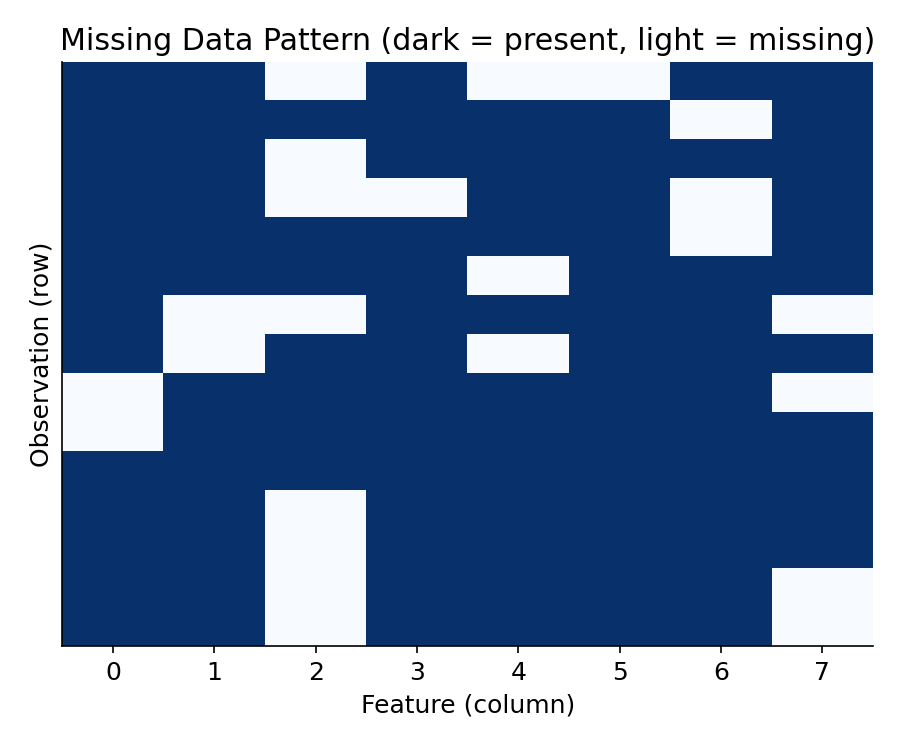
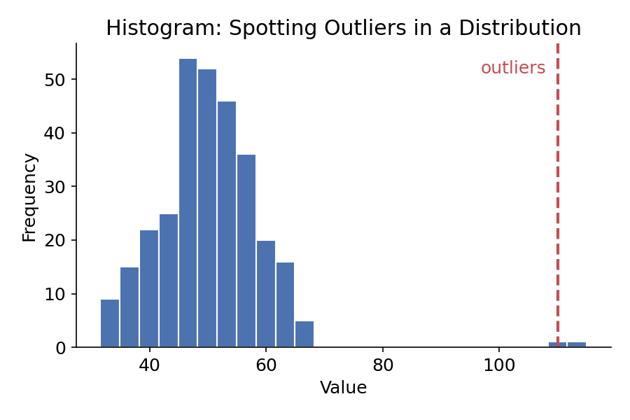
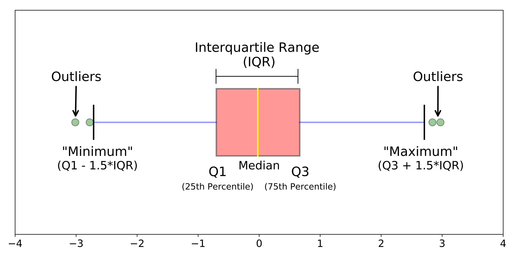
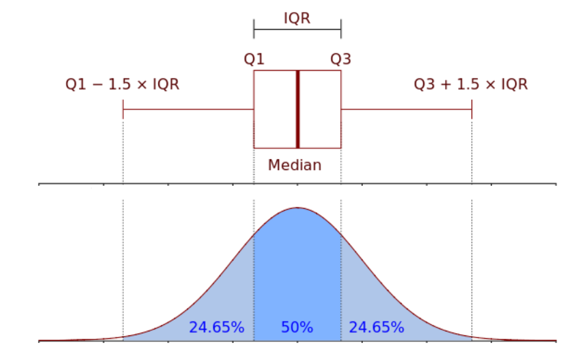

# Data Cleaning for Machine Learning

## Learning Goals

In this section, we will cover:
- Why data cleaning is important for machine learning
- Issues that arise with messy data
- How to identify duplicate or unnecessary data
- Policies for dealing with missing data
- Policies for dealing with outliers

---

## Why Is Data Cleaning So Important?

Decisions and analytics are increasingly driven by data and models. If the data feeding a model is flawed, the model's output will be flawed too - this is often called the **"garbage in, garbage out"** effect. No amount of clever modeling can fully compensate for bad input data, so cleaning is one of the highest-leverage steps in any ML workflow.

### Key building blocks of an ML workflow

Understanding these terms makes it easier to see *why* each cleaning step matters:

| Term | Definition |
|---|---|
| **Observation** | A single instance of data - usually one row in a dataset |
| **Features** | The input variables / information available for each observation |
| **Labels** | The output variable(s) a model is trying to predict |
| **Model** | The hypothesized relationship between features and labels |
| **Algorithm** | The computer program used to estimate (fit) a model from data |

Dirty data corrupts each of these building blocks: bad observations skew what the model learns, bad features add noise instead of signal, and bad labels teach the model the wrong answer entirely.

### The three main data problems organizations face

1. **Lack of data** - not enough observations, or not enough coverage of important cases, to learn a reliable pattern.
2. **Too much data** - high-volume, high-velocity data that is expensive to store, move, and process, and may contain a lot of irrelevant noise.
3. **Bad data** - data that is inaccurate, inconsistent, incomplete, or duplicated.

Getting data into a clean, trustworthy state is a prerequisite for scaling AI and ML across an organization - it's the unglamorous work that makes everything downstream possible.

---

## How Can Data Be Messy?

Common sources of "messiness" include:

- Duplicate or unnecessary data
- Inconsistent text and typos (e.g., "USA", "U.S.A.", "United States" all meaning the same thing)
- Missing data
- Outliers
- **Data sourcing issues**, such as:
  - Data pulled from multiple systems
  - Different database types or schemas
  - Data split across on-premises and cloud environments
- ...and more (encoding mismatches, timestamp/timezone inconsistencies, unit mismatches, etc.)

---

## Duplicate or Unnecessary Data

Pay close attention to duplicate records, and investigate **why** duplicates exist before deleting them - sometimes they represent a real data pipeline bug (e.g., the same event logged twice); other times they're legitimate repeated observations (e.g., the same customer purchasing twice).

It's also worth reviewing which features you're bringing into your dataset and **filtering out** ones that aren't useful. Be careful not to over-filter, though - a feature that looks irrelevant now may turn out to be useful later, and once it's dropped it can be costly to go back and re-collect it.

---

## Policies for Missing Data

There are three broad strategies for handling missing values, each with trade-offs:

| Strategy | What it does | Pros | Cons |
|---|---|---|---|
| **Remove** | Delete the row (or column) with missing values | Simple; avoids introducing artificial values | Loses information; can shrink your dataset significantly if missingness is common |
| **Impute** | Replace missing values with a substituted value (e.g., mean, median, mode, or a model-based estimate) | Preserves sample size; keeps the feature usable | Can understate variability; may introduce bias if data isn't missing at random |
| **Mask** | Create an explicit "missing" category/flag instead of guessing a value | Keeps information that "it was missing" (which can itself be predictive); avoids fabricating a value | Only works well for categorical features; adds an extra category/dimension to manage |

The right choice depends on *why* the data is missing (missing completely at random, missing at random, or missing not at random), how much is missing, and how the missing feature will be used downstream.

---

## Outliers

An **outlier** is an observation that lies unusually far from the rest of the data. Outliers are often - but not always - data entry errors, measurement glitches, or edge cases that don't represent the phenomenon the model is trying to explain. Left unaddressed, they can pull model fits in misleading directions or inflate error metrics.

> **Important:** not all outliers are "bad." Some outliers are genuinely informative - a fraud case, a rare disease, a record-breaking sale - and removing them blindly can throw away exactly the signal you care about. Always investigate an outlier before deciding what to do with it.

### How to find outliers

**1. Visual methods (plots)**

- **Histogram** - shows the shape of a distribution; outliers appear as isolated bars far from the main cluster.
- **Density plot** - a smoothed version of a histogram; makes it easier to see the overall shape and any long tails.
- **Box plot** - summarizes a distribution using quartiles and explicitly marks points beyond a threshold as outliers.

**2. Statistical methods**

- **Interquartile Range (IQR)** - the range between the 25th percentile (Q1) and 75th percentile (Q3). A common rule of thumb flags any point below `Q1 − 1.5×IQR` or above `Q3 + 1.5×IQR` as an outlier.
- **Standard deviation** - flags points that fall more than roughly 2–3 standard deviations from the mean (most useful for roughly normal/bell-shaped data).

**3. Residual-based methods** (used once a model is already fit)

- **Standardized residuals** - residuals rescaled to have unit variance, making it easier to spot unusually large errors.
- **Deleted residuals** - the residual for a point computed from a model fit *without* that point, which prevents the point from influencing its own residual.
- **Studentized residuals** - deleted residuals further scaled to account for a point's leverage, giving a more reliable measure of how unusual an observation really is.

### Policies for handling outliers

- **Remove** them - appropriate when an outlier is clearly a data error and adds no useful information.
- **Assign** the mean or median value - treats the outlier similarly to a missing value that gets imputed.
- **Transform** the variable - e.g., a log or square-root transform can shrink the influence of extreme values without discarding them.
- **Predict** what the value should be:
  - Using "similar" observations (nearest neighbors) to estimate a likely value.
  - Using regression to predict a more plausible value from other features.
- **Keep them**, but choose models that are naturally resistant to outliers (e.g., tree-based models, robust regression) rather than models sensitive to extreme values (e.g., ordinary least squares).

---

## Learning Recap

In this section, we discussed:
- Why data cleaning is important for machine learning
- Issues that arise with messy data
- How to identify duplicate or unnecessary data
- Policies for dealing with missing data
- Policies for dealing with outliers

------------------------------------------

|  | **MPCoding** *Machine Learning Tutorial Series*     |
|---|---|

  © 2026 MPCoding. Educational materials are free to use with proper attribution.

