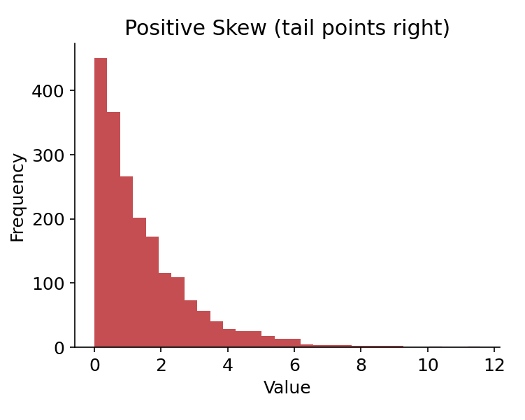
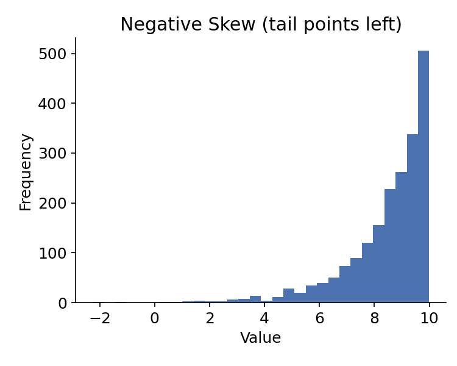
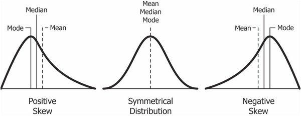
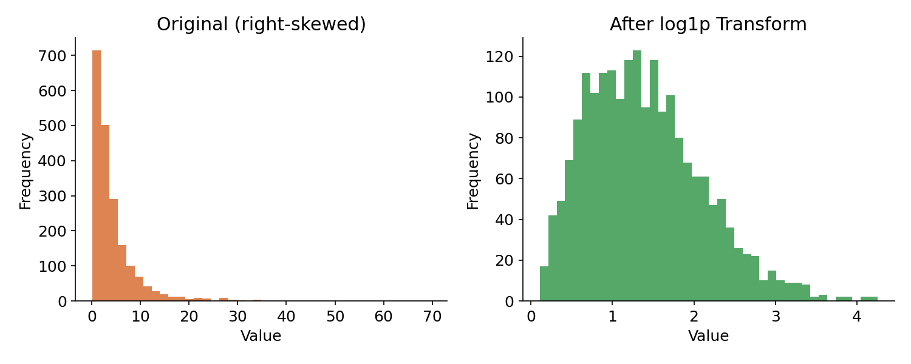
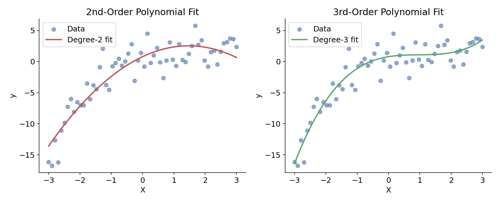
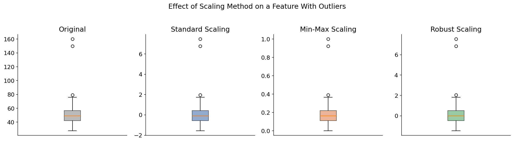

# Feature Engineering and Variable Transformation

## Learning Goals

In this section, we will cover:
- Feature engineering and variable transformation
- Feature encoding
- Feature scaling

---

## Transforming Data: Background

Many ML models make assumptions about the data they're given. A common example is the **linear regression model**, which assumes a *linear* relationship between the feature variables and the target (outcome) variable.

For example, a linear model relating feature variables $X_1$ and $X_2$ to a target (label) variable $y$ looks like:

$$y_{\beta}(x) = \beta_0 + \beta_1 X_1 + \beta_2 X_2$$

Here, $\beta = (\beta_0, \beta_1, \beta_2)$ represents the model's **parameters** - the values the algorithm learns from the data.

When the raw data doesn't satisfy a model's assumptions (e.g., linearity, normally distributed residuals), we transform it first so the model can do its job properly.

---

## Transformation of Data Distributions

Linear regression assumes that the model's **residuals** (the differences between predicted and actual values) are **normally distributed**. In practice, features and target variables are often **skewed** - their distribution is stretched out or "distorted" to one side rather than being symmetric around the center.

**Data transformations** are one of the main tools for correcting skew before modeling.

| Positive Skew | Negative Skew |
|---|---|
| Tail extends toward larger values | Tail extends toward smaller values |
|  |   |

### Comparison of negative and positive skew histograms



```python
# Useful transformation functions
from numpy import log, log1p
from scipy.stats import boxcox
```

```python
# Plot a histogram and density/KDE plot
# Note: sns.distplot() is deprecated - use histplot (with kde=True) instead
sns.histplot(data, bins=20, kde=True)
```

```python
import numpy as np

# Apply a log transform to a skewed column
log_data = np.log(data["stocks"])

# Plot the transformed distribution
sns.histplot(log_data, bins=20, kde=True)
```

> **Tip:** `np.log()` fails on zero or negative values. If your data can include zeros, use `np.log1p()` (which computes `log(1 + x)`) instead.

### Transformations: Log Features

**Log transformations** are especially useful before linear regression because they can turn a multiplicative or exponential relationship into an additive, linear one - which is exactly the form linear regression expects:

$$y_{\beta}(x) = \beta_0 + \beta_1 \log(x)$$



### Transformations: Polynomial Features

Sometimes the relationship between a feature and the target isn't linear at all - it curves. Rather than switching to a completely different type of model, we can add **polynomial features** (e.g., $x^2$, $x^3$) as new inputs. This lets us capture curved relationships while still using the same linear model machinery - we're just feeding it richer features.

A 2nd-order (quadratic) relationship:

$$y_{\beta}(x) = \beta_0 + \beta_1 x + \beta_2 x^2$$

And a 3rd-order (cubic) relationship, which can capture even more curvature:

$$y_{\beta}(x) = \beta_0 + \beta_1 x + \beta_2 x^2 + \beta_3 x^3$$




The image above shows both fits side by side - notice how the higher-order polynomial can bend to follow more complex patterns in the data, but also runs a greater risk of overfitting if pushed too far.

```python
# Import the class containing the transformation methods
from sklearn.preprocessing import PolynomialFeatures

# Create an instance of the class (choose the number of degrees)
poly_feat = PolynomialFeatures(degree=2)

# Fit to the data, then transform it into polynomial features
poly_feat = poly_feat.fit(X_data)
X_poly = poly_feat.transform(X_data)
```

---

## Variable Selection: Background

**Variable selection** involves choosing which set of features to include in a model. Before they can be used, variables often need to be transformed. In addition to log and polynomial transformations, this can involve:

- **Encoding** - converting non-numeric features into numeric ones
- **Scaling** - putting numeric features on comparable scales

---

## Feature Encoding: Types of Features

**Encoding** is typically applied to categorical features - those that take non-numeric values. There are two primary types:

- **Nominal** - categories with no inherent order (e.g., colors like `Red`/`Green`/`Blue`, or `True`/`False`)
- **Ordinal** - categories with a meaningful order (e.g., `Low` < `Medium` < `High`)

## Feature Encoding: Approaches

Common approaches to encoding include:

- **Binary encoding** - converts a variable to `0` or `1`; suitable for variables with exactly two possible values (e.g., `True`/`False`)
- **One-hot encoding** - converts a variable with multiple categories into several binary (`0`/`1`) columns, one per category. This adds new columns to the dataset.
- **Ordinal encoding** - converts ordered categories into a single numeric column, usually as consecutive integers (e.g., `0, 1, 2, 3, ...`) that preserve the category order

---

## Feature Scaling: Background

**Feature scaling** adjusts a variable's range so that features with very different scales become comparable.

Different continuous (numeric) features often live on very different scales - for example, `age` (roughly 0–100) versus `annual_income` (tens of thousands). Left unscaled, models that are sensitive to magnitude (like linear regression with regularization, **k-nearest neighbors**, or gradient descent–based models) can end up implicitly treating the larger-scale feature as "more important," simply because its raw numbers are bigger - not because it's actually more predictive.

### Example: why scale matters

Imagine comparing `age` (0–100) and `annual_income` (0–200,000) directly in a distance-based calculation. A $10,000 difference in income would swamp a 10-year difference in age, even if age is actually the stronger predictor. Scaling puts both features on a level playing field before the model ever sees them.

## Feature Scaling: Approaches

Common approaches to scaling include:

- **Standard scaling** - converts a feature to a **standard normal** variable by subtracting the mean and dividing by the standard deviation. Result: mean ≈ 0, standard deviation ≈ 1.
- **Min-max scaling** - maps a variable's minimum to `0` and maximum to `1`, so all values fall in the `(0, 1)` interval. This method is **sensitive to outliers**, since a single extreme value stretches the whole scale.
- **Robust scaling** - similar to min-max scaling, but uses the **interquartile range** (75th percentile minus 25th percentile) instead of the min/max. Because it ignores the extremes, the resulting values can fall *outside* `(0, 1)` - but it's much less thrown off by outliers.



Notice how the outliers compress the "useful" range of the min-max–scaled feature toward zero, while robust scaling keeps the bulk of the data more spread out and usable.

---

## Common Variable Transformations - Summary

| Feature Type | Description | Typical Transformation |
|---|---|---|
| **Continuous** | Numerical values | Standard, min-max, or robust scaling |
| **Nominal** | Categorical, unordered (e.g., `True`/`False`) | Binary or one-hot encoding |
| **Ordinal** | Categorical, ordered (e.g., movie ratings) | Ordinal encoding (`0, 1, 2, 3, ...`) |

```python
# Useful classes for scaling variables
from sklearn.preprocessing import StandardScaler, MinMaxScaler, RobustScaler

# Useful classes/functions for encoding categorical variables
from sklearn.preprocessing import LabelEncoder, LabelBinarizer, OneHotEncoder
from pandas import get_dummies

# Useful classes for encoding ordinal variables
from sklearn.feature_extraction import DictVectorizer
from sklearn.preprocessing import OrdinalEncoder
```

---

## Learning Recap

In this section, we covered:
- Why data transformations matter for models like linear regression
- Log and polynomial transformations for handling skew and non-linear relationships
- Feature encoding for nominal and ordinal categorical variables
- Feature scaling approaches (standard, min-max, robust) and when each is appropriate

------------------------------------------

|  | **MPCoding**<br>*Machine Learning Tutorial Series*<br><br> [](https://www.youtube.com/@MP-Coding) [](https://github.com/madhawapolkotuwa) |
|---|---|

<p align="left" style="font-size: 0.85em; color: gray; margin-top: 10px;">
  © 2026 MPCoding. Educational materials are free to use with proper attribution.
</p>