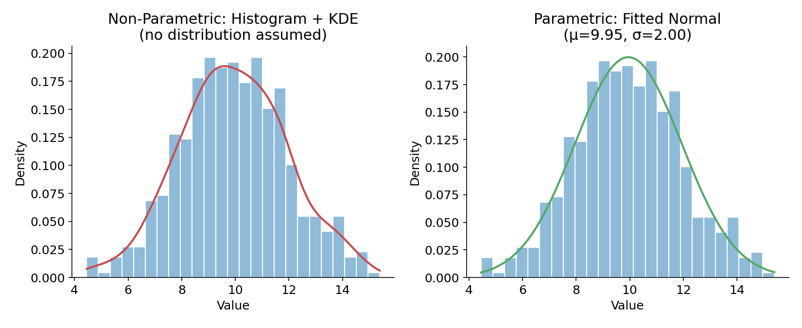
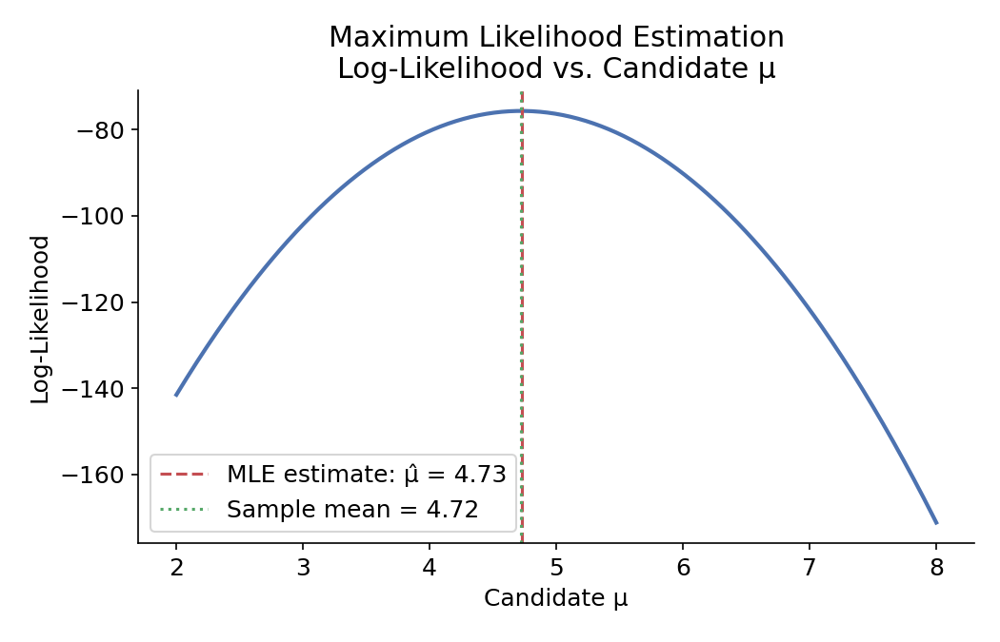
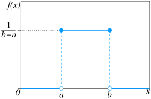
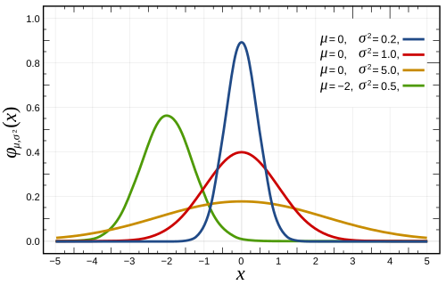
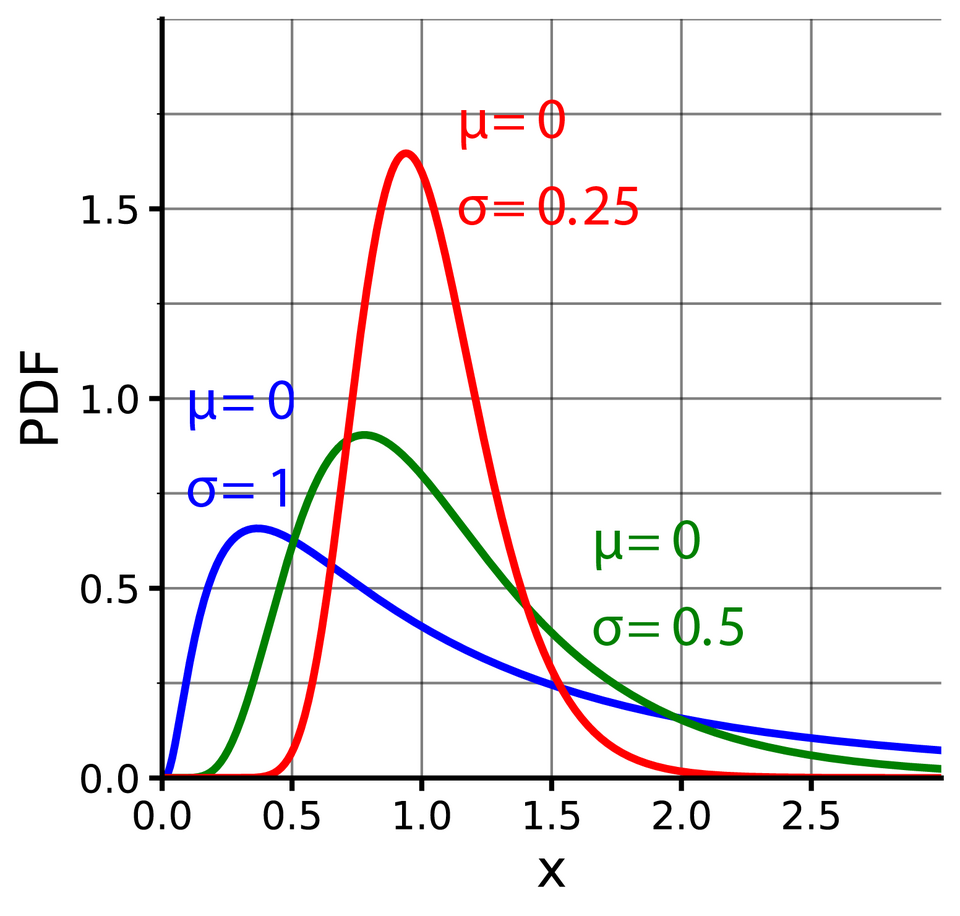
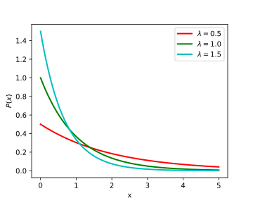
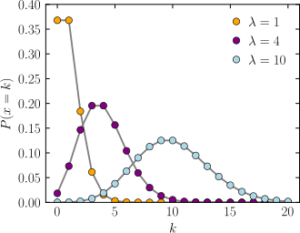
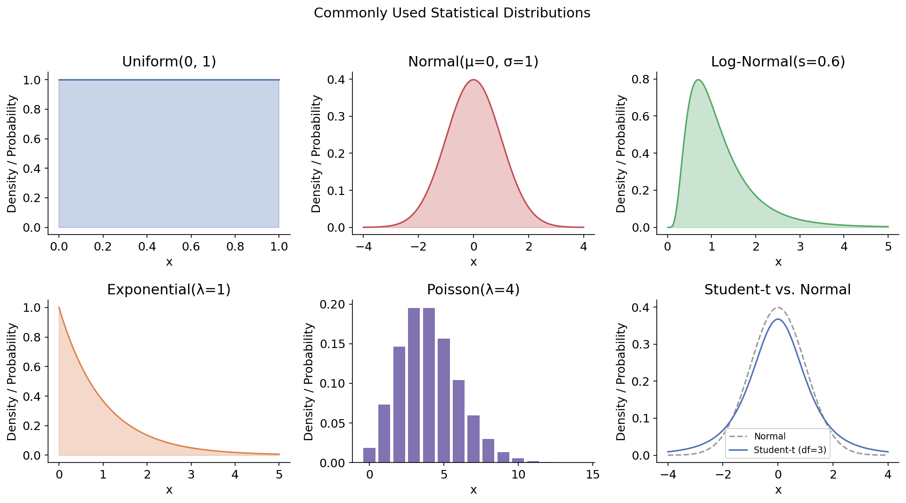
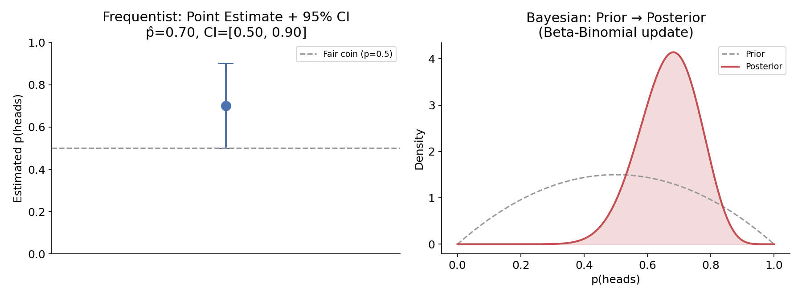

# Estimation and Inference

### Learning Goals

- Statistical estimation and inference
- Parametric and non-parametric approaches to modeling
- Common statistical distributions
- Frequentist vs. Bayesian statistics


## Estimation vs Enference
**Estimation**: applying an algorithm to data to compute a value, e.g. the sample mean:

$$\bar{x} = \frac{1}{n} \sum_{i=1}^{n} x_i$$

**Inference**: putting an accuracy/uncertainty on that estimate, e.g. the standard error of the mean: 

$$\sqrt{\sum_{i=1}^{n}\frac{(x_i - \bar{x})^2}{n -1}} $$

```python
import numpy as np

data = np.array([12, 15, 11, 18, 20, 14, 16, 13])

x_bar = np.mean(data)
n = len(data)
se = np.std(data, ddof=1) / np.sqrt(n)   # ddof=1 -> sample std. dev.

print(f"Estimate (mean): {x_bar:.2f}")
print(f"Standard error:  {se:.2f}")
# Estimate (mean): 14.88
# Standard error:  1.08
```

## Machine Learning and Statistical Inference

**ML** and **Statistical inference** are closely related    
both use data to learn about the distribution that generated it (the **data-generating process**, or DGP).    

* Sometimes we care about the whole distribution.
* Sometimes we only care about specific features of it (e.g., the `mean`, a `regression coefficient`).

Example:     
A linear regression that predicts house price from square footage is doing estimation (`fitting` `coefficients`). Reporting a p-value or confidence interval on the square-footage coefficient is inference, it tells you how much to trust that estimate.

## Parametric vs. Non-Parametric

A **statistical model** is a set of candidate distributions (or regressions) that could have generated the data. Inference is the process of using data to figure out which one (or which region of that set) is most plausible.

### Parametric Models

A finite number of parameters fully describes the model.

Example: the Normal distribution, with parameters μ (mean) and 𝜎 (standard deviation):   
$$
f(x) = \frac{1}{\sigma\sqrt{2\pi}} e^{-\frac{1}{2}\left(\frac{x-\mu}{\sigma}\right)^2}
$$

### Non-Parametric Models

Fewer assumptions, we don't assume the data follows any particular distribution (**distribution-free inference**). This doesn't mean we assume nothing; it just means the "shape" is learned from the data itself rather than fixed in advance.

**Example**: building an empirical distribution (e.g., a histogram or KDE) directly from the data, with no fixed functional form.

```python
from scipy import stats
import matplotlib.pyplot as plt

data = np.random.normal(loc=10, scale=2, size=500)

# Non-parametric: let the histogram/KDE speak for itself
kde = stats.gaussian_kde(data)

# Parametric: assume Normal, estimate its 2 parameters
mu_hat, sigma_hat = stats.norm.fit(data)
print(f"Fitted Normal: mu={mu_hat:.2f}, sigma={sigma_hat:.2f}")
```


The non-parametric approach (left) just describes the shape it sees. The parametric approach (right) assumes the data is Normal and boils it down to two numbers, μ and 𝜎.

Here the question is how ice cream sales depend on temperature, and the two approaches answer it very differently.   

[parametric_vs_nonparametric_fit](parametric_vs_nonparametric_fit.html)

-------------------------

### Parametric Models

**Maximum Likelihood Estimation (MLE)**  
The most common way to estimate a parametric model's parameters is **maximum likelihood estimation**: find the parameter values that make the *observed data* as probable as possible under the assumed distribution.

For 𝑛 independent observations, the likelihood is:

$$L(\theta) = \prod_{i=1}^{n} f(x_i \mid \theta)$$

In practice we maximize the **log-likelihood** instead (numerically easier, same maximizer):     

$$\ell(\theta) = \sum_{i=1}^{n} \log f(x_i \mid \theta)$$

```python
sample = np.random.normal(loc=5, scale=1.5, size=40)

# scipy can find the MLE for us directly:
mu_mle, sigma_mle = stats.norm.fit(sample)
print(f"MLE estimate: mu={mu_mle:.2f}, sigma={sigma_mle:.2f}")
print(f"Sample mean:  {sample.mean():.2f}")
```

  
For a Normal distribution, the MLE of $\mu$ turns out to be exactly the sample mean : the plot above shows the log-likelihood peaking right at that value.

The example is a coin again, so it connects to the earlier topics. You flip it and see 7 heads and 3 tails (the widget keeps the same 70/30 split as you add flips). The question is: what is the heads chance of the coin that produced this?    

[mle_and_log_likelihood_coin](mle_and_log_likelihood_coin.html)

--------------------------

### Commonly Used Distribution

#### Uniform
     
_image source: Wikipedia_

#### Normal/Gaussian 
  
_image source: Wikipedia_    

#### Log Normal
  
_image source: Wikipedia_   

### Exponetial
  
_image source: Wikipedia_   

### Poisson
  
_image source: Wikipedia_   

```python
from scipy import stats

stats.uniform(loc=0, scale=1)      # Uniform(0, 1)
stats.norm(loc=0, scale=1)         # Normal(mean=0, std=1)
stats.lognorm(s=0.6)               # Log-Normal (s = shape/sigma of underlying normal)
stats.expon(scale=1)               # Exponential(mean=1)
stats.poisson(mu=4)                # Poisson(lambda=4) -- discrete
stats.t(df=3)                      # Student-t (heavier tails than Normal)
```



| Distribution | Type | Common use |
|---|---|---|
| **Uniform** | Continuous | All outcomes in a range equally likely |
| **Normal / Gaussian** | Continuous | Symmetric, bell-shaped; sums/averages of many effects (Central Limit Theorem) |
| **Log-Normal** | Continuous | Right-skewed data whose *log* is Normal (e.g., income, stock prices) |
| **Exponential** | Continuous | Time between independent events (e.g., time until next arrival) |
| **Poisson** | Discrete | Count of events in a fixed interval (e.g., number of arrivals per hour) |
| **Student-t** | Continuous | Like Normal but heavier tails; used for small samples / uncertain variance |

---

## Frequentist vs. Bayesian Statistic

Both frameworks often use the same underlying math - what differs is the **interpretation** of probability and parameters.

### Frequentist 

- Probability = long-run frequency over many, many repetitions of an experiment.
- Approach: 
    * **(1)** derive the probabilistic properties of a procedure (e.g., a confidence interval formula), 
    * **(2)** apply that procedure directly to the observed data.
- Parameters are treated as fixed, unknown constants - not random.

### Bayesian

- Parameters are treated as random variables with their own probability distributions.
- Start with a **prior distribution** (belief before seeing data).
- Update it using the observed data (via Bayes' theorem) to get a **posterior distribution** (belief after seeing data).

### Worked Example: Is a Coin Fair?

Flip a coin 20 times, observe 14 heads.

```python
n_flips, n_heads = 20, 14
p_hat = n_heads / n_flips

# --- Frequentist: point estimate + 95% confidence interval ---
se = np.sqrt(p_hat * (1 - p_hat) / n_flips)
ci = (p_hat - 1.96 * se, p_hat + 1.96 * se)
print(f"Frequentist estimate: p_hat={p_hat:.2f}, 95% CI={ci}")

# --- Bayesian: Beta prior updated by Binomial data -> Beta posterior ---
prior_a, prior_b = 2, 2                      # mild prior belief centered at 0.5
post_a, post_b = prior_a + n_heads, prior_b + (n_flips - n_heads)
posterior_mean = post_a / (post_a + post_b)
print(f"Bayesian posterior mean: {posterior_mean:.2f}")
```
```
Frequentist estimate: p_hat=0.70, 95% CI=(0.4989, 0.9011)
Bayesian posterior mean: 0.67
```



- The **frequentist** result (left) is a single point estimate ($\hat{p}=0.70$) plus an interval describing how that estimation *procedure* would behave if repeated many times.
- The **Bayesian** result (right) is a full posterior distribution over $p$, shrunk slightly toward the prior's center (0.5) since the prior still carries some weight - giving a posterior mean of 0.67 rather than exactly 0.70.

------------

Here’s an interactive version of the classic example: a coin you suspect might be biased. Drag the slider to flip it more times and watch how each camp reasons about it.

[frequentist_vs_bayesian_coin](frequentist_vs_bayesian_coin.html)

------------


## Recap

- **Estimation** computes a value from data; **inference** attaches uncertainty to it.
- **Parametric** models assume a fixed distributional form with finitely many parameters; **non-parametric** models let the data define the shape.
- **MLE** finds the parameter values that make the observed data most probable.
- Common distributions (Uniform, Normal, Log-Normal, Exponential, Poisson, Student-t) each fit different real-world data patterns.
- **Frequentist** and **Bayesian** statistics often share the same math, but differ in interpretation: fixed unknown parameters vs. probability distributions over parameters that get updated by data.


------------------------------------------

|  | **MPCoding**<br>*Machine Learning Tutorial Series*<br><br> [](https://www.youtube.com/@MP-Coding) [](https://github.com/madhawapolkotuwa) |
|---|---|

<p align="left" style="font-size: 0.85em; color: gray; margin-top: 10px;">
  © 2026 MPCoding. Educational materials are free to use with proper attribution.
</p>
