# Hypothesis Testing

* What a hypothesis is, and how a test turns data into a decision
* The classical (frequentist) approach: decision rules, error types, power
* The Bayesian approach: likelihood ratios and updating priors
* A worked example with coin tossing (code and figures included)

## 1. What is a hypothesis?

A **hypothesis** is a statement about a population parameter, for example "this coin lands heads 70% of the time" or "the new model's mean error is lower than the old one's."

We usually set up two competing hypotheses:
* The **null hypothesis**, $H_0$: the default or "nothing special" claim.
* The **alternative hypothesis**, $H_1$ (or $H_A$): the claim we would act on if the data disagree with $H_0$.

Which one is called the null depends on how the problem is set up. A common convention is to make $H_0$ the claim whose wrongful rejection would be the more costly mistake.

A test statistic is a number computed from the data (here: the count of heads) that we use to choose between $H_0$ and $H_1$.

----------

## 2. Decision rules (classical approach)

A **hypothesis testing procedure** is a rule that says:

* for which values of the test statistic we **fail to reject $H_0$**, and
* for which values (the **rejection region**) we **reject $H_0$** and go with **$H_1$**.

You will hear the advice that you can reject $H_0$ but never accept $H_0$ (absence of evidence is not proof). That is a careful statement about what a single test proves. In applied work the practical question is usually simply: which of two paths do we take in this project? The test gives a principled, repeatable way to choose.


### Two ways to be wrong

|                     | $H_0$ true                     | $H_1$ true                      |
|---------------------|--------------------------------|---------------------------------|
| **Reject $H_0$**    | Type I error (prob. $\alpha$)  | Correct (prob. $1-\beta$ = power) |
| **Don't reject**    | Correct                        | Type II error (prob. $\beta$)   |

- $\alpha$ is the **significance level**: the probability of rejecting $H_0$ when it is true.
- **Power** $=1-\beta$: the probability of rejecting $H_0$ when $H_1$ is true.
- Moving the decision boundary trades one error for the other.
- A **p-value** is the probability, assuming $H_0$ is true, of seeing a test statistic at least as extreme as the one observed. It is *not* the probability that $H_0$ is true.

---
 
## 3. The Bayesian approach
 
In the Bayesian interpretation there is **no decision boundary** built into the method. Instead we:
 
1. Put a **prior** probability on each hypothesis, $P(H_1)$ and $P(H_2)$.
2. Compute how likely the data are under each hypothesis (the **likelihood**).
3. Combine them with Bayes' rule to get **posterior** probabilities.
The output is a probability for each hypothesis. If a yes/no action is needed, you pick a threshold afterwards based on the costs of being wrong.
 
---
 
## 4. Example: which coin did I toss?
 
- **Coin 1** has $P(\text{heads}) = 0.7$.
- **Coin 2** has $P(\text{heads}) = 0.5$ (fair).
Pick one coin without looking, toss it 10 times, and record the number of heads $x$.
**Given $x$, which coin did you toss?**
 
The number of heads is Binomial $(10, p)$:
 
$$P(x \mid p) = \binom{10}{x} p^x (1-p)^{10-x}$$
 
```python
import numpy as np
import matplotlib
matplotlib.use("Agg")
import matplotlib.pyplot as plt
from scipy.stats import binom
 
N = 10
P1, P2 = 0.7, 0.5          # coin 1 (biased), coin 2 (fair)
x = np.arange(N + 1)
pmf1, pmf2 = binom.pmf(x, N, P1), binom.pmf(x, N, P2)

# 1. Likelihood tables
print("x      :", x)
print("coin 1 :", np.round(pmf1, 4))
print("coin 2 :", np.round(pmf2, 4))

c1, c2 = "#d1495b", "#00798c"


fig, ax = plt.subplots(1, 2, figsize=(10, 3.6), sharey=True)
ax[0].bar(x, pmf2, color=c2); ax[0].set_title("Coin 2: P(heads) = 0.5")
ax[1].bar(x, pmf1, color=c1); ax[1].set_title("Coin 1: P(heads) = 0.7")
for a in ax: a.set_xlabel("Number of heads in 10 tosses"); a.set_xticks(x)
ax[0].set_ylabel("Probability")
plt.tight_layout(); plt.savefig("../images/coin_distributions.png", dpi=150); plt.show()
```
 
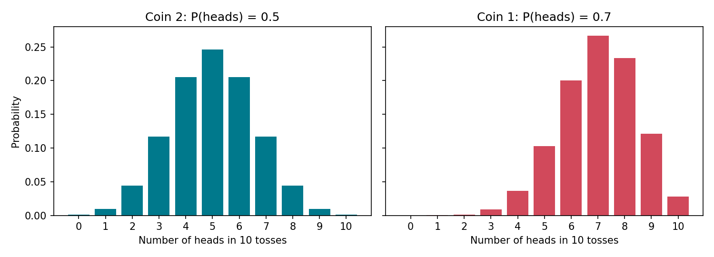
 
Probability of each head count:
 
| x heads | 0 | 1 | 2 | 3 | 4 | 5 | 6 | 7 | 8 | 9 | 10 |
|---|---|---|---|---|---|---|---|---|---|---|---|
| Coin 1 (p=0.7) | 0.000 | 0.000 | 0.001 | 0.009 | 0.037 | 0.103 | 0.200 | 0.267 | 0.234 | 0.121 | 0.028 |
| Coin 2 (p=0.5) | 0.001 | 0.010 | 0.044 | 0.117 | 0.205 | 0.246 | 0.205 | 0.117 | 0.044 | 0.010 | 0.001 |
 
---
 
## 5. The likelihood ratio
 
The **likelihood ratio** compares how well each hypothesis explains the observed data:
 
$$\Lambda(x) = \frac{P(x \mid H_1)}{P(x \mid H_2)}$$
 
Suppose we saw **three heads**:
 
- $P(3 \mid \text{coin 1}) = 0.009$ and $P(3 \mid \text{coin 2}) = 0.117$
- $\dfrac{P_2(3)}{P_1(3)} = \dfrac{0.117}{0.009} \approx 13$
So coin 2 (the fair coin) was about **13 times more likely** than coin 1 to produce 3 heads.
 
```python
lr = pmf1 / pmf2             # P(x|H1)/P(x|H2); likelihood ratio, coin 1 over coin 2
post1 = pmf1 / (pmf1 + pmf2) # P(H1|x) with priors 1/2

print("LR (coin1/coin2):", np.round(lr, 3))
print("P(coin1|x)      :", np.round(post1, 3))
print("x=3: P2(3)/P1(3) =", pmf2[3] / pmf1[3], " P(coin2|3) =", 1 - post1[3])

plt.figure(figsize=(6.5, 3.8))
plt.plot(x, np.log10(lr), "o-", color="k")
plt.axhline(0, color="gray", ls="--")
plt.xticks(x); plt.xlabel("Number of heads x")
plt.ylabel("log10( P(x|coin 1) / P(x|coin 2) )")
plt.title("Evidence for coin 1 (above 0) vs coin 2 (below 0)")
plt.tight_layout(); plt.savefig("../images/likelihood_ratio.png", dpi=150); plt.show()

```
 
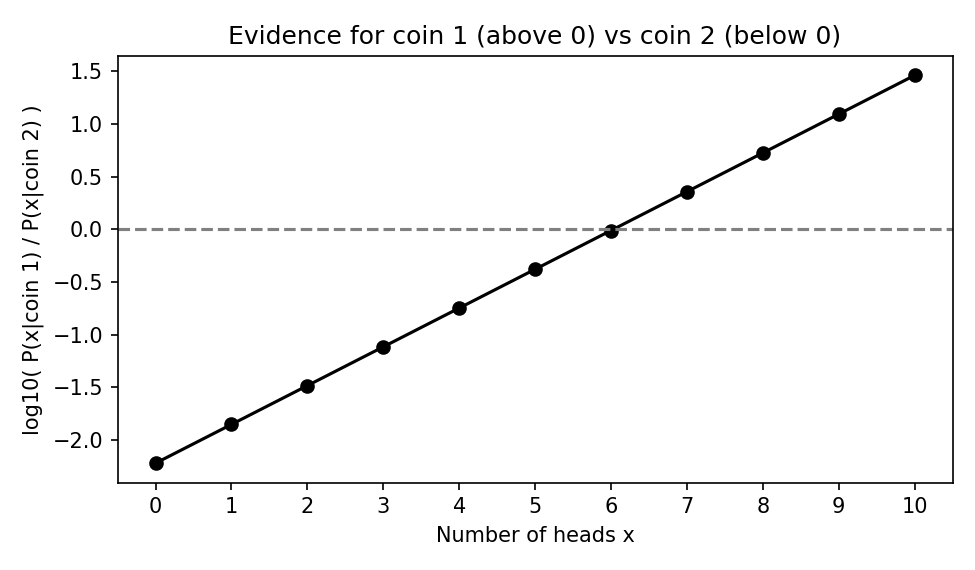
 
The ratio equals 1 (log = 0) near $x = 6$. Fewer heads favour the fair coin, more heads favour the biased coin.
 
---
 
## 6. Bayesian interpretation: updating priors
 
We chose the coin at random, so before seeing data:
 
$$P(H_1) = P(H_2) = \tfrac{1}{2}$$
 
After seeing data $x$, Bayes' rule gives the **posterior**:
 
$$P(H_1 \mid x) = \frac{P(x \mid H_1)\,P(H_1)}{P(x)}, \qquad P(x) = \sum_i P(x\mid H_i)P(H_i)$$
 
and in ratio form:
 
$$\underbrace{\frac{P(H_1 \mid x)}{P(H_2 \mid x)}}_{\text{posterior odds}} = \underbrace{\frac{P(H_1)}{P(H_2)}}_{\text{prior odds}} \times \underbrace{\frac{P(x \mid H_1)}{P(x \mid H_2)}}_{\text{likelihood ratio}}$$
 
The likelihood ratio does **not** depend on the priors. It tells us how much to update whatever prior we started with.
 
For 3 heads with equal priors, the odds are 1 : 1 times 1 : 13, so
 
$$P(\text{coin 2} \mid x=3) = \frac{0.117}{0.117 + 0.009} \approx 0.93$$
 
```python
plt.figure(figsize=(6.5, 3.8))
plt.bar(x, post1, color=c1, label="P(coin 1 | x)")
plt.bar(x, 1 - post1, bottom=post1, color=c2, label="P(coin 2 | x)")
plt.xticks(x); plt.xlabel("Number of heads x"); plt.ylabel("Posterior probability")
plt.legend(loc="upper left", fontsize=8, framealpha=0.9)
plt.title("Bayesian answer: no hard cutoff, just probabilities")
plt.tight_layout(); plt.savefig("../images/posterior.png", dpi=150); plt.show()

```
 
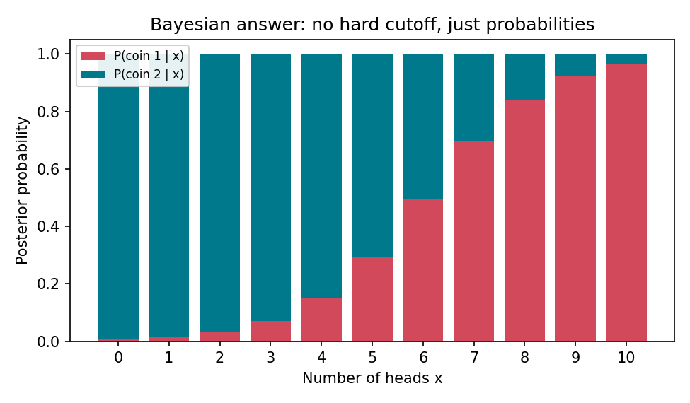
 
A different prior (say, you were 90% sure you grabbed coin 1) would shift these posteriors, but the likelihood ratio stays the same.
 
### Updating one toss at a time
 
Bayes' rule can be applied repeatedly: today's posterior becomes tomorrow's prior.
 
```python
rng = np.random.default_rng(0)
tosses = rng.random(60) < P1            # truth: coin 1
p = 0.5; path = [p]
for t in tosses:
    l1 = P1 if t else 1 - P1
    l2 = P2 if t else 1 - P2
    p = p * l1 / (p * l1 + (1 - p) * l2)
    path.append(p)
plt.figure(figsize=(6.5, 3.8))
plt.plot(path, color=c1); plt.axhline(0.5, color="gray", ls="--")
plt.xlabel("Number of tosses"); plt.ylabel("P(coin 1 | data so far)")
plt.title("Posterior evolves toss by toss (true coin = coin 1)")
plt.tight_layout(); plt.savefig("../images/posterior_updating.png", dpi=150); plt.show()
```
 
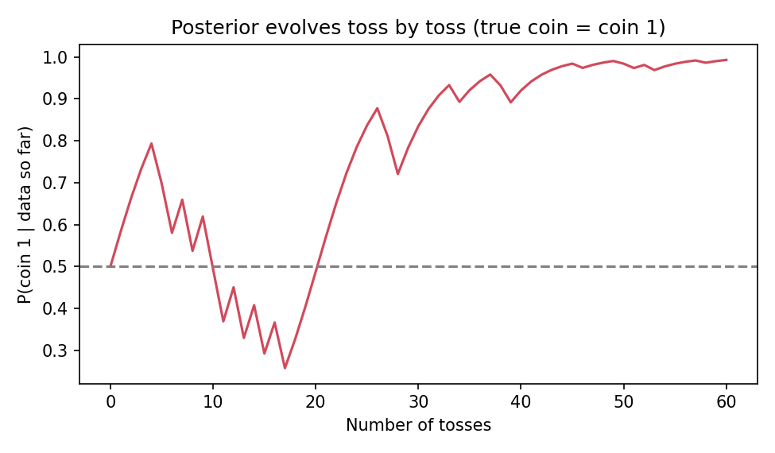
 
---
 
## 7. The classical version of the same problem
 
Take $H_0$: the coin is fair (coin 2) and $H_1$: $p = 0.7$ (coin 1). Use the decision rule
 
> **Reject $H_0$ if the number of heads is at least 8.**
 
```python
c = 8
alpha = binom.sf(c - 1, N, P2)   # P(X >= 8 | fair)   -> 0.0547
power = binom.sf(c - 1, N, P1)   # P(X >= 8 | p=0.7)  -> 0.3828
beta  = 1 - power                #                     -> 0.6172
print(f"c={c}: alpha={alpha:.4f} power={power:.4f} beta={1-power:.4f}")

plt.figure(figsize=(8, 4))
w = 0.38
plt.bar(x - w/2, pmf2, w, color=c2, label="H0 true (fair coin)")
plt.bar(x + w/2, pmf1, w, color=c1, label="H1 true (p = 0.7)")
plt.axvline(c - 0.5, color="k", ls="--")
plt.text(c - 0.45, max(pmf1) * 0.95, f"reject H0\nif x >= {c}", fontsize=9, va="top")
plt.xticks(x); plt.xlabel("Number of heads x"); plt.ylabel("Probability")
plt.title(f"Decision rule: alpha = {alpha:.3f}, power = {power:.3f}")
plt.legend(fontsize=8, loc="upper left")
plt.tight_layout(); plt.savefig("../images/decision_rule.png", dpi=150); plt.show()
```
 
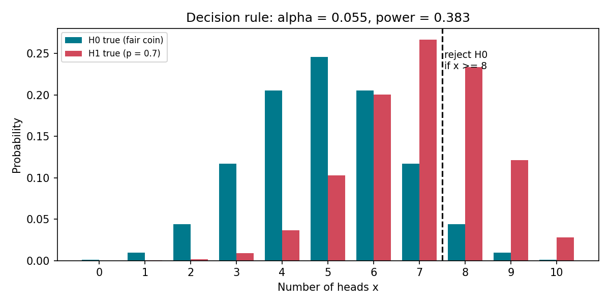
 
- $\alpha \approx 0.055$: about a 5.5% chance of wrongly rejecting a fair coin.
- Power $\approx 0.38$: only a 38% chance of catching the biased coin with 10 tosses.
Lowering the cutoff raises power but also raises $\alpha$. The cure for weak power is more data: more tosses separate the two distributions.
 
---

live check:

[hypothesis testing two coins](https://htmlpreview.github.io/?https://github.com/madhawapolkotuwa/MPCoding_Machine_Learning/blob/main/01_Data_Preprocessing_And_EDA/006_hypothesis/hypothesis_testing_two_coins.html)


---
 
## 8. Side by side
 
| | Classical | Bayesian |
|---|---|---|
| Output | Reject / don't reject $H_0$ | Probability of each hypothesis |
| Needs priors? | No | Yes |
| Key quantity | Test statistic, $\alpha$, p-value, power | Likelihood ratio, posterior |
| Decision boundary | Set in advance (via $\alpha$) | Chosen afterwards from costs, if needed |
| Shared ingredient | The likelihood $P(\text{data}\mid H)$ | The likelihood $P(\text{data}\mid H)$ |
 
Both approaches are built on the same likelihoods. They differ in what they do with them.
 
## Takeaways
 
- A hypothesis is a claim about a parameter; a test is a rule mapping data to a decision.
- Every decision rule trades off Type I and Type II errors.
- The likelihood ratio measures how strongly the data favour one hypothesis over another.
- Bayes' rule says: posterior odds = prior odds × likelihood ratio.

---------------------------------------------

# P-Values, Hypothesis Testing, and Power

**What you will learn**

1. Hypothesis testing: the significance level ($\alpha$) and p-values
2. The F-statistic (testing whether a regression model explains anything at all)
3. Multiple testing and the Bonferroni correction
4. Power and sample size


## 1. Hypothesis testing: significance level and p-values

### The big idea in one paragraph

A hypothesis test asks: *"If nothing interesting were going on, how surprising would my data be?"* "Nothing interesting going on" is the **null hypothesis**, $H_0$. We know (or can work out) what data look like when $H_0$ is true; that is the **null distribution**. We boil our data down to one number, the **test statistic**, and see where it lands on the null distribution. If it lands far out in a tail, our data would be very surprising under $H_0$, so we reject $H_0$.

The recipe:

1. State $H_0$ (the boring explanation) and $H_1$ (what you suspect).
2. **Choose the significance level $\alpha$ before looking at the data.**
3. Compute the test statistic.
4. Find the rejection region (or equivalently, the p-value).
5. Decide: reject $H_0$ or fail to reject $H_0$.

### The significance level $\alpha$

The significance level $\alpha$ is a probability threshold. We reject the null hypothesis when the data are so extreme that results this extreme would happen with probability less than $\alpha$ if $H_0$ were true.

Equivalently, $\alpha$ is the probability of a **Type I error** (rejecting $H_0$ when $H_0$ is actually true) that we are willing to tolerate. If you use $\alpha = 0.05$ and $H_0$ is true, then in the long run 5% of your experiments will wrongly reject it.

Choosing $\alpha$ is somewhat arbitrary, but common choices are $0.05$ and $0.01$ (and sometimes $0.10$). Use smaller values when a false alarm is costly (say, approving a drug).

> **Why we must choose $\alpha$ before computing the test statistic.**
> If you look at your p-value first and then pick the $\alpha$ that makes your result "significant", the 5% guarantee is gone: you have tuned the threshold to the answer you wanted. The same goes for trying many tests, subsets, or variables and reporting only the one that worked. This is called **p-hacking**, and it produces "discoveries" that are just noise (see Section 3 for how fast this goes wrong). The fix is simple: decide your hypotheses, test, and $\alpha$ in advance, and report everything you tried.


### The p-value

The **p-value** is the probability, *assuming $H_0$ is true*, of getting a test statistic at least as extreme as the one you observed.

A handy equivalent definition: **the p-value is the smallest significance level at which you would reject the null hypothesis.** So the decision rule is easy:

- if $p < \alpha$: reject $H_0$
- if $p \ge \alpha$: fail to reject $H_0$

### Worked example: the coffee machine (a z-test)

A café's machine is supposed to pour **250 ml** per cup. From long experience the pour-to-pour standard deviation is known: $\sigma = 8$ ml. You measure $n = 36$ cups and find an average of $\bar{x} = 253$ ml. Is the machine miscalibrated?

- **Hypotheses:** $H_0: \mu = 250$ versus $H_1: \mu \neq 250$ (two-sided: too much *or* too little would be a problem)
- **Significance level:** $\alpha = 0.05$, chosen before looking at the data
- **Test statistic:** how many standard errors is the sample mean from the $H_0$ value?

$$z = \frac{\bar{x} - \mu_0}{\sigma / \sqrt{n}} = \frac{253 - 250}{8/\sqrt{36}} = \frac{3}{1.3333} = 2.25$$

- **p-value:** under $H_0$, $z$ follows a standard normal distribution. The two-sided p-value is $P(|Z| \ge 2.25) = 0.0244$.
- **Decision:** $0.0244 < 0.05$, so we reject $H_0$.

**In plain language:** if the machine really poured 250 ml on average, an average this far off (3 ml in either direction, from 36 cups) would turn up only about 2.4% of the time. That is rare enough, by our 5% standard, to conclude the machine is probably off.

Here is the code that computes these numbers and draws the picture:

```python
# 01_z_test.py
import os
import numpy as np
import matplotlib.pyplot as plt
from scipy import stats

os.makedirs("images", exist_ok=True)

# --- The data: a coffee machine that should pour 250 ml per cup ---
mu0 = 250      # value claimed by H0 (ml)
sigma = 8      # known standard deviation of one cup (ml)
n = 36         # cups we measured
xbar = 253     # the average we actually observed (ml)
alpha = 0.05   # chosen BEFORE looking at the data

# --- Test statistic and p-value (two-sided) ---
se = sigma / np.sqrt(n)               # standard error of the mean
z = (xbar - mu0) / se                 # how many standard errors from H0's value?
p_value = 2 * stats.norm.sf(abs(z))   # P(|Z| >= |z|) if H0 is true
z_crit = stats.norm.ppf(1 - alpha / 2)

print(f"standard error = {se:.4f}")
print(f"z statistic    = {z:.4f}")
print(f"critical value = +/-{z_crit:.4f}")
print(f"p-value        = {p_value:.4f}")
print("Decision:", "reject H0" if p_value < alpha else "fail to reject H0")

# --- Plot the null distribution, rejection region and p-value ---
x = np.linspace(-4, 4, 800)
y = stats.norm.pdf(x)

fig, ax = plt.subplots(figsize=(9, 4.5))
ax.plot(x, y, color="black", lw=2, label="Null distribution: N(0, 1)")

# rejection region (total area = alpha)
ax.fill_between(x, y, where=(x <= -z_crit) | (x >= z_crit), color="tab:red",
                alpha=0.35, label=f"Rejection region (area = {alpha})")
# p-value area: as extreme or more extreme than what we observed, in both tails
ax.fill_between(x, y, where=(x <= -abs(z)) | (x >= abs(z)), color="tab:blue",
                alpha=0.55, label=f"p-value = {p_value:.4f}")
ax.axvline(z, color="tab:blue", ls="--")
ax.annotate(f"observed z = {z:.2f}", xy=(z, 0.02), xytext=(z + 0.3, 0.12),
            arrowprops=dict(arrowstyle="->"))

ax.set_xlabel("z (standard errors away from the H0 mean)")
ax.set_ylabel("density")
ax.set_title("Two-sided z-test: rejection region vs. p-value")
ax.legend()
fig.savefig("../images/01_null_rejection_pvalue.png", dpi=150, bbox_inches="tight")
plt.show(fig)
```

Output:

```text
standard error = 1.3333
z statistic    = 2.2500
critical value = +/-1.9600
p-value        = 0.0244
Decision: reject H0
```

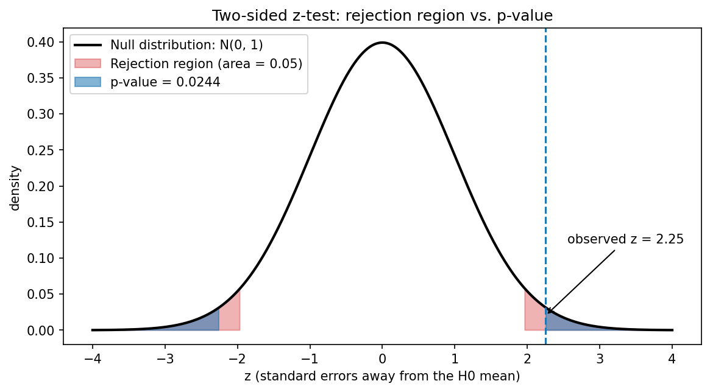


---

live check:

[p-value fair coin](https://htmlpreview.github.io/?https://github.com/madhawapolkotuwa/MPCoding_Machine_Learning/blob/main/01_Data_Preprocessing_And_EDA/006_hypothesis/p_value_fair_coin.html)

---

How to read the graph:

- The black curve is the **null distribution**: what $z$ looks like if $H_0$ is true.
- The **red** area is the **rejection region**. Its total area is exactly $\alpha = 0.05$ (0.025 in each tail). Any test statistic beyond $\pm 1.96$ lands there.
- The **blue** area is the **p-value**: the area beyond our observed $z = 2.25$ (and beyond $-2.25$, because the test is two-sided).
- Our $z$ is past the red boundary, which is the same as saying the blue area is smaller than the red area. The two views, "statistic in the rejection region" and "$p < \alpha$", always agree.


### How the choice of $\alpha$ changes the decision

The same data can lead to different decisions under different $\alpha$ values. That is exactly why $\alpha$ must be fixed in advance.

```python
# 02_alpha_choices.py
import os
import numpy as np
import matplotlib.pyplot as plt
from scipy import stats

os.makedirs("images", exist_ok=True)

z_obs = 2.25                      # observed z from the coffee example
p_value = 2 * stats.norm.sf(z_obs)
x = np.linspace(-4, 4, 800)
y = stats.norm.pdf(x)

fig, axes = plt.subplots(1, 3, figsize=(14, 4), sharey=True)
for ax, alpha in zip(axes, [0.10, 0.05, 0.01]):
    z_crit = stats.norm.ppf(1 - alpha / 2)
    reject = p_value < alpha
    ax.plot(x, y, color="black", lw=2)
    ax.fill_between(x, y, where=(abs(x) >= z_crit), color="tab:red", alpha=0.4)
    ax.axvline(z_obs, color="tab:blue", ls="--", lw=2)
    ax.set_title(f"alpha = {alpha}  (critical value = +/-{z_crit:.2f})\n"
                 f"{'REJECT' if reject else 'FAIL TO REJECT'} H0", fontsize=11)
    ax.set_xlabel("z")
    print(f"alpha={alpha:<5} critical value=+/-{z_crit:.3f}  "
          f"p={p_value:.4f}  ->  {'reject' if reject else 'fail to reject'}")
axes[0].set_ylabel("density")
fig.suptitle(f"Same data (observed z = {z_obs}, blue line), three different alphas", y=1.04)
fig.savefig("../images/02_alpha_choices.png", dpi=150, bbox_inches="tight")
plt.show(fig)
```

Output:

```text
alpha=0.1   critical value=+/-1.645  p=0.0244  ->  reject
alpha=0.05  critical value=+/-1.960  p=0.0244  ->  reject
alpha=0.01  critical value=+/-2.576  p=0.0244  ->  fail to reject
```

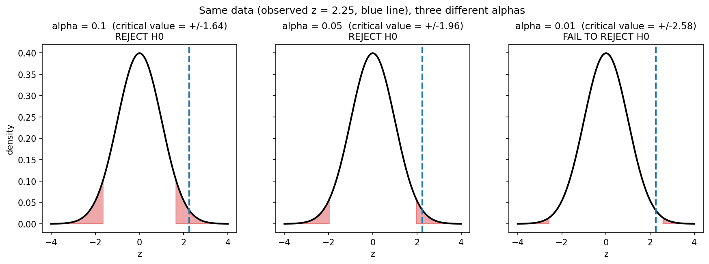


Smaller $\alpha$ pushes the rejection region further into the tails, so you need stronger evidence to reject. With $p = 0.0244$ we reject at $\alpha = 0.10$ and $0.05$ but not at $0.01$. If we were allowed to choose $\alpha$ after seeing $p = 0.0244$, we could always pick one that gives the answer we like. Don't.

### The confidence interval: the other side of the same coin

A **confidence interval** is the set of null values you would *not* reject. A 95% confidence interval for the mean contains exactly those values $\mu_0$ for which a two-sided test at $\alpha = 0.05$ fails to reject.

For our example: $253 \pm 1.96 \times 1.3333 = (250.39,\ 255.61)$. The value 250 is outside the interval, which matches our rejection. (It is only just outside, which matches the p-value of 0.024 being not far below 0.05.)

### Common misconceptions

| Misconception | Reality |
|---|---|
| "The p-value is the probability that $H_0$ is true." | No. It is computed *assuming* $H_0$ is true. It is the probability of data this extreme given $H_0$, not the probability of $H_0$ given the data. |
| " $p = 0.0244$ means a 2.44% chance the result is a fluke." | Not quite. It means that *if* there were no real effect, you'd see data this extreme 2.44% of the time. |
| "A small p-value means a large or important effect." | No. With a huge sample, a trivial effect can give a tiny p-value. Always look at the size of the effect, not just $p$. |
| " $p > 0.05$ proves $H_0$ is true." | No. It means you didn't find enough evidence against it. Maybe there was no effect, or maybe your test was too weak (low power, see Section 4). |
| "0.05 is a law of nature." | It's a convention. A result with $p = 0.049$ is not meaningfully different from one with $p = 0.051$. |
| "I can pick $\alpha$ after seeing the p-value." | That is p-hacking. Choose $\alpha$ first. |

---


## 2. The F-statistic

### The question it answers

In a linear regression with predictors $x_1, \dots, x_k$,

$$y = \beta_0 + \beta_1 x_1 + \dots + \beta_k x_k + \varepsilon,$$

the **F-test** asks one overall question: *"Do any of the predictors help at all?"*

- $H_0$: all the slope coefficients are zero, $\beta_1 = \beta_2 = \dots = \beta_k = 0$. In other words, the data can be modeled by the intercept alone (just the average of $y$). The intercept $\beta_0$ is not part of $H_0$.
- $H_1$: at least one $\beta_j \neq 0$.

Reject the null if the p-value is small enough.

### How the F-statistic is built

Compare two models:

- the **simple model** (intercept only): its leftover error is the *total sum of squares*, $TSS = \sum (y_i - \bar{y})^2$
- the **full model** (all predictors): its leftover error is the *residual sum of squares*, $RSS = \sum (y_i - \hat{y}_i)^2$

Adding predictors can only reduce the error. The question is whether it reduced it by more than you'd expect from luck. The F-statistic is the ratio

$$F = \frac{(TSS - RSS)/k}{RSS/(n-k-1)} = \frac{\text{error explained per predictor}}{\text{error left over per degree of freedom}}.$$

- Numerator: how much error the model removed, per predictor used.
- Denominator: the noise level (the typical leftover error).
- If the predictors are useless, $F$ is typically around 1. If they genuinely help, $F$ is large.

Under $H_0$ (and the usual regression assumptions: independent, roughly normal errors with constant variance), $F$ follows an **F-distribution** with $k$ and $n-k-1$ degrees of freedom. It is always positive and skewed to the right, and we only reject for **large** values, so the rejection region is a single right tail.

### Worked example: two datasets, same predictors

We have $n = 40$ observations and $k = 2$ predictors (think "hours studied" and "hours slept"). We fit the same two predictors to two different outcomes:

- **Dataset A:** the outcome really depends on the predictors (true $\beta_1 = 1.5$, $\beta_2 = -1.0$).
- **Dataset B:** the outcome is pure noise (true $\beta_1 = \beta_2 = 0$).

Hypotheses, for each: $H_0: \beta_1 = \beta_2 = 0$ versus $H_1:$ at least one is nonzero. Significance level: $\alpha = 0.05$. The test statistic is $F$ with $(2, 37)$ degrees of freedom, and the 5% critical value is $3.252$.

```python
# 03_f_test.py
import os
import numpy as np
import matplotlib.pyplot as plt
from scipy import stats

os.makedirs("images", exist_ok=True)
rng = np.random.default_rng(42)          # fixed seed -> same numbers every run

n, k = 40, 2                             # 40 observations, 2 predictors

def f_test(X, y):
    """Overall F-test for H0: all slope coefficients (betas) are zero."""
    A = np.column_stack([np.ones(len(y)), X])        # add intercept column
    beta_hat, *_ = np.linalg.lstsq(A, y, rcond=None)
    rss = np.sum((y - A @ beta_hat) ** 2)            # residual sum of squares (full model)
    tss = np.sum((y - y.mean()) ** 2)                # total sum of squares (intercept-only model)
    df1, df2 = k, len(y) - k - 1
    F = ((tss - rss) / df1) / (rss / df2)
    p = stats.f.sf(F, df1, df2)                      # P(F >= observed | H0)
    return beta_hat, F, p, df1, df2

X = rng.normal(size=(n, k))                          # two predictors, e.g. hours studied, hours slept

# Dataset A: the predictors really matter (true betas 1.5 and -1.0)
y_signal = 5 + 1.5 * X[:, 0] - 1.0 * X[:, 1] + rng.normal(scale=2.0, size=n)
# Dataset B: the predictors are irrelevant (true betas are both 0)
y_noise = 5 + rng.normal(scale=2.0, size=n)

fig, axes = plt.subplots(1, 2, figsize=(13, 4.3))
for ax, (name, y) in zip(axes, [("A: real signal", y_signal), ("B: pure noise", y_noise)]):
    beta_hat, F, p, df1, df2 = f_test(X, y)
    f_crit = stats.f.ppf(0.95, df1, df2)
    print(f"Dataset {name}: betas = {np.round(beta_hat[1:], 3)}, "
          f"F({df1},{df2}) = {F:.3f}, critical (5%) = {f_crit:.3f}, p = {p:.4g}")

    xmax = max(8, F * 1.15)
    x = np.linspace(0, xmax, 800)
    pdf = stats.f.pdf(x, df1, df2)
    ax.plot(x, pdf, color="black", lw=2, label=f"F({df1}, {df2}) null distribution")
    ax.fill_between(x, pdf, where=x >= f_crit, color="tab:red", alpha=0.35,
                    label=f"Rejection region (alpha = 0.05, F > {f_crit:.2f})")
    ax.fill_between(x, pdf, where=x >= F, color="tab:blue", alpha=0.6,
                    label=f"p-value = {p:.4g}")
    ax.axvline(F, color="tab:blue", ls="--")
    ax.set_title(f"Dataset {name}: F = {F:.2f}")
    ax.set_xlabel("F")
    ax.set_ylabel("density")
    ax.set_ylim(0, 1.05)
    ax.legend(fontsize=8)

fig.savefig("../images/03_f_distribution.png", dpi=150, bbox_inches="tight")
plt.show()
```

Output:

```text
Dataset A: real signal: betas = [ 1.438 -0.994], F(2,37) = 11.656, critical (5%) = 3.252, p = 0.0001187
Dataset B: pure noise: betas = [-0.957  0.551], F(2,37) = 2.994, critical (5%) = 3.252, p = 0.06237
```

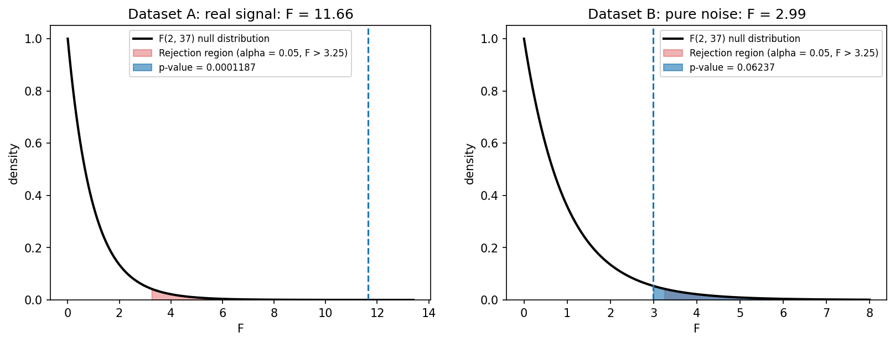

| | Fitted betas | $F(2, 37)$ | p-value | Decision at $\alpha = 0.05$ |
|---|---|---|---|---|
| A: real signal | 1.438, -0.994 | 11.656 | 0.0001187 | Reject $H_0$ |
| B: pure noise | -0.957, 0.551 | 2.994 | 0.06237 | Fail to reject $H_0$ |

**Plain language:**

- **A:** If the predictors were worthless, an $F$ as large as 11.66 would happen about 1 time in 8,400. We conclude the predictors help explain the outcome.
- **B:** An $F$ of 2.99 is below the critical value of 3.25 and the p-value (0.062) is above 0.05. Noise alone produces an $F$ this large about 6% of the time. We do **not** reject $H_0$. We have not *proven* the predictors are useless; we simply have no convincing evidence that they help.

Notes on the graph: the black curve is the F-distribution under $H_0$; the red area is the rejection region (area $0.05$); the blue area is the p-value. The tail is thin, which is why the shaded areas look small. Dataset B's statistic falls just short of the red boundary, a good reminder of why a threshold decided *in advance* matters: $p = 0.062$ is "almost significant", but "almost" is not a result.

---

## 3. Multiple testing and the Bonferroni correction

### The problem: every extra test is another lottery ticket

If you run one test at $\alpha = 0.05$ and $H_0$ is true, you have a 5% chance of a false alarm. But if you run many tests looking for something significant, the chance of **at least one** false alarm grows.

Here's the reasoning for $m$ independent tests where every null hypothesis is true:

- Probability a single test does **not** make a Type I error: $1 - \alpha = 0.95$
- Probability that **all $m$** tests avoid a Type I error: $(1-\alpha)^m = 0.95^m$ (multiply, because the tests are independent)
- So the probability of **at least one** Type I error is the complement:

$$P(\text{at least one Type I error}) = 1 - (1-\alpha)^m$$

This is the formula in the draft notes, written there as $1-(1-0.05)^{\text{tests}}$. It is exact for independent tests and an approximation when the tests are correlated (the draft's "approximately").

| Number of tests $m$ | $1-(1-0.05)^m$ |
|---|---|
| 1 | 0.050 |
| 5 | 0.226 |
| 10 | 0.401 |
| 20 | 0.642 |
| 50 | 0.923 |
| 100 | 0.994 |

With 20 tests there is a 64% chance of at least one "significant" result even when nothing real is going on. This is how p-hacking works in practice: test enough variables, subgroups, or outcomes, and something will cross $p < 0.05$ by luck.

### The fix: the Bonferroni correction

If you run $m$ tests and want the probability of **any** false alarm to stay at most $\alpha$, test each one at the smaller level

$$\alpha_{\text{Bonferroni}} = \frac{\alpha}{m}.$$

Why it works: plugging $\alpha/m$ into the formula gives $1 - (1 - \alpha/m)^m$, which is always just under $\alpha$ (e.g. $0.0488$ for $\alpha = 0.05$ and $m = 20$). More generally, the "union bound" says the chance that *at least one* of $m$ events happens is no larger than the sum of their individual chances, $m \times \alpha/m = \alpha$. This holds even when the tests are not independent.

The code below prints the table above next to the Bonferroni version, checks the formula by simulation (all nulls true; under $H_0$ p-values are uniformly distributed between 0 and 1), and draws the graph:

```python
# 04_multiple_tests.py
import os
import numpy as np
import matplotlib.pyplot as plt

os.makedirs("images", exist_ok=True)
alpha = 0.05

# --- The formula: P(at least one false positive) = 1 - (1 - alpha)^m ---
print(" m   no correction   Bonferroni (alpha/m)")
for m in [1, 5, 10, 20, 50, 100]:
    raw = 1 - (1 - alpha) ** m
    bonf = 1 - (1 - alpha / m) ** m
    print(f"{m:>3}   {raw:>12.3f}   {bonf:>14.4f}")

# --- Check the formula by simulation (all null hypotheses are TRUE) ---
rng = np.random.default_rng(0)
m, reps = 20, 100_000
p_values = rng.uniform(size=(reps, m))    # when H0 is true, p-values are uniform on [0, 1]
any_raw = (p_values < alpha).any(axis=1).mean()
any_bonf = (p_values < alpha / m).any(axis=1).mean()
print(f"\nSimulation with m={m} true nulls ({reps:,} repetitions):")
print(f"  formula:            {1 - (1 - alpha) ** m:.3f}")
print(f"  simulated, raw:     {any_raw:.3f}")
print(f"  simulated, Bonf.:   {any_bonf:.3f}")

# --- Plot ---
ms = np.arange(1, 101)
fig, ax = plt.subplots(figsize=(9, 4.5))
ax.plot(ms, 1 - (1 - alpha) ** ms, lw=2.5, color="tab:red",
        label=r"No correction: $1-(1-0.05)^m$")
ax.plot(ms, 1 - (1 - alpha / ms) ** ms, lw=2.5, color="tab:green",
        label=r"Bonferroni: $1-(1-0.05/m)^m$")
ax.axhline(alpha, color="gray", ls=":", label="0.05 (what we wanted)")
ax.scatter([m], [1 - (1 - alpha) ** m], color="black", zorder=5)
ax.annotate(f"m = {m}: {1 - (1 - alpha) ** m:.0%}", xy=(m, 1 - (1 - alpha) ** m),
            xytext=(m + 8, 0.55), arrowprops=dict(arrowstyle="->"))
ax.set_xlabel("number of tests, m")
ax.set_ylabel("P(at least one Type I error)")
ax.set_title("Running more tests inflates the false-positive risk")
ax.set_ylim(0, 1.02)
ax.legend(loc="center right")
fig.savefig("../images/04_multiple_testing.png", dpi=150, bbox_inches="tight")
plt.show()
```

Output:

```text
 m   no correction   Bonferroni (alpha/m)
  1          0.050           0.0500
  5          0.226           0.0490
 10          0.401           0.0489
 20          0.642           0.0488
 50          0.923           0.0488
100          0.994           0.0488

Simulation with m=20 true nulls (100,000 repetitions):
  formula:            0.642
  simulated, raw:     0.642
  simulated, Bonf.:   0.048
```

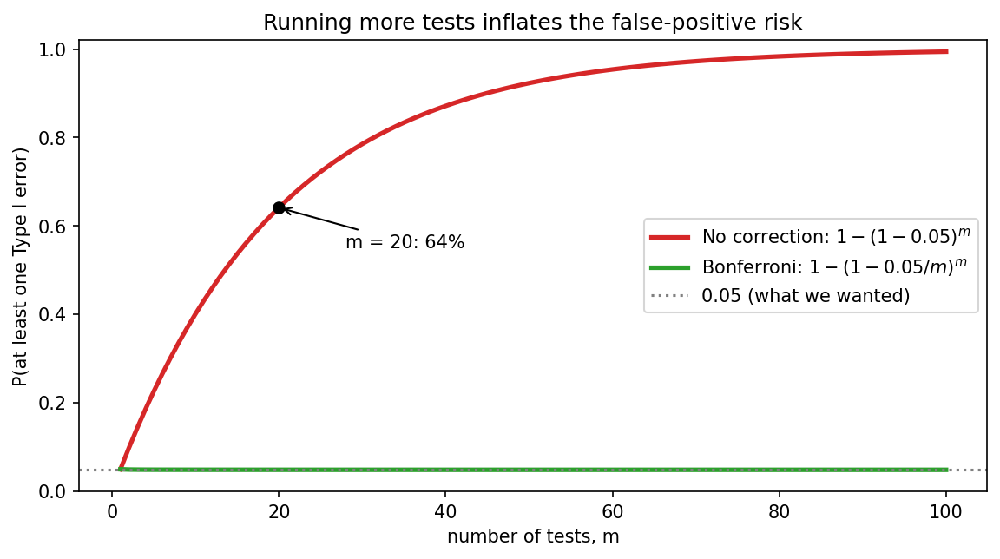

The red curve (no correction) climbs toward 100%. The green Bonferroni curve stays pinned just under 5% no matter how many tests you run. In the simulation, 20 tests with no correction gave at least one false positive 64.2% of the time (the formula says 0.642), versus 4.8% with Bonferroni.

### Worked example: ten genes

You test 10 genes for a link to a disease, using $\alpha = 0.05$ for the family of 10 tests. For each: $H_0$ = the gene is unrelated to the disease. The test statistic is whatever suits your data (say a t-statistic), summarized by its p-value. Suppose the p-values are as in the code below.

The Bonferroni threshold is $0.05/10 = 0.005$. Reject only where $p < 0.005$:

```python
# 05_bonferroni_example.py
import numpy as np

alpha = 0.05
genes = ["gene_A", "gene_B", "gene_C", "gene_D", "gene_E",
         "gene_F", "gene_G", "gene_H", "gene_I", "gene_J"]
p_values = np.array([0.001, 0.008, 0.020, 0.041, 0.049,
                     0.110, 0.260, 0.480, 0.730, 0.910])

m = len(p_values)
threshold = alpha / m            # Bonferroni: divide alpha by the number of tests
print(f"Bonferroni threshold = {alpha}/{m} = {threshold}\n")
print(f"{'test':<8}{'p-value':>8}  {'p < 0.05?':<10}{'p < threshold?':<15}")
for g, p in zip(genes, p_values):
    print(f"{g:<8}{p:>8.3f}  {str(p < alpha):<10}{str(p < threshold):<15}")

print(f"\nSignificant without correction: {(p_values < alpha).sum()}")
print(f"Significant with Bonferroni:    {(p_values < threshold).sum()}")

# Equivalent view: multiply each p-value by m (cap at 1) and compare with 0.05
adj = np.minimum(p_values * m, 1.0)
print("\nBonferroni-adjusted p-values:", np.round(adj, 3))
```

Output:

```text
Bonferroni threshold = 0.05/10 = 0.005

test     p-value  p < 0.05? p < threshold? 
gene_A     0.001  True      True           
gene_B     0.008  True      False          
gene_C     0.020  True      False          
gene_D     0.041  True      False          
gene_E     0.049  True      False          
gene_F     0.110  False     False          
gene_G     0.260  False     False          
gene_H     0.480  False     False          
gene_I     0.730  False     False          
gene_J     0.910  False     False          

Significant without correction: 5
Significant with Bonferroni:    1

Bonferroni-adjusted p-values: [0.01 0.08 0.2  0.41 0.49 1.   1.   1.   1.   1.  ]
```

**Decision in plain language:** without correction, five genes look "significant", but we expect about $10 \times 0.05 = 0.5$ false alarms among 10 tests even if no gene mattered. After Bonferroni, only gene_A survives, with $p = 0.001$ (adjusted $p = 0.01$). That is the one finding strong enough to withstand having tried 10 times.

**The trade-off:** Bonferroni is simple and safe, but it is **conservative**. By making each test stricter, you lower your power (next section), so real effects like gene_B ($p = 0.008$) get missed. With very many tests (thousands of genes), people often turn to less strict methods that control the *proportion* of false discoveries instead (e.g. Benjamini-Hochberg), but Bonferroni is the right starting point.

---

## 4. Power and sample size

### Two ways to be wrong, two ways to be right

|  | $H_0$ is actually true | $H_0$ is actually false |
|---|---|---|
| **Reject $H_0$** | **Type I error** (false alarm), probability $\alpha$ | Correct: a true detection, probability $1-\beta$ = **power** |
| **Fail to reject $H_0$** | Correct, probability $1-\alpha$ | **Type II error** (a miss), probability $\beta$ |

- $\alpha$ = P(reject $H_0$ | $H_0$ true): the false alarm rate you choose.
- $\beta$ = P(fail to reject $H_0$ | $H_0$ false): the miss rate.
- **Power** $= 1 - \beta$ = P(reject $H_0$ | $H_0$ false): the chance your test detects a real effect.

A common target is **80% power**: if the effect is real, you'd find it 4 times out of 5.

### What power depends on

Power depends on four things, and you can trade between them:

1. **Effect size**: how far the truth is from $H_0$. Bigger effects are easier to detect. Often measured in standard-deviation units, e.g. Cohen's $d = (\mu_1 - \mu_0)/\sigma$. In the coffee example, a 3 ml shift with $\sigma = 8$ is $d = 0.375$.
2. **Sample size $n$**: more data means a smaller standard error ($\sigma/\sqrt{n}$), so the null and alternative distributions of the sample mean overlap less.
3. **Significance level $\alpha$**: a stricter $\alpha$ pushes the rejection region outward, which lowers power.
4. **Noise $\sigma$**: noisier data means lower power.

### Seeing power: the two-distribution picture

Suppose the coffee machine really does pour 253 ml on average (so $H_0$ is false) and we test $n = 36$ cups with $\alpha = 0.05$. The sample mean follows one distribution if $H_0$ is true (centered at 250) and another if the truth is 253. The rejection region is fixed by the $H_0$ curve (area $\alpha$). Power is how much of the *253 curve* falls inside the rejection region.

```python
# 06_power_picture.py
import os
import numpy as np
import matplotlib.pyplot as plt
from scipy import stats

os.makedirs("images", exist_ok=True)

mu0, mu1 = 250, 253       # H0 mean, and the TRUE mean we hope to detect (ml)
sigma, n, alpha = 8, 36, 0.05
se = sigma / np.sqrt(n)

# Critical values for the sample mean under H0 (two-sided)
lo, hi = stats.norm.ppf([alpha / 2, 1 - alpha / 2], loc=mu0, scale=se)

# Power = P(sample mean lands in the rejection region | true mean = mu1)
power = stats.norm.cdf(lo, mu1, se) + stats.norm.sf(hi, mu1, se)
beta = 1 - power
print(f"standard error      = {se:.4f}")
print(f"rejection region:     mean < {lo:.3f} or mean > {hi:.3f}")
print(f"Type II error (beta)= {beta:.4f}")
print(f"power (1 - beta)    = {power:.4f}")

x = np.linspace(244, 259, 1000)
fig, ax = plt.subplots(figsize=(10, 4.8))
ax.plot(x, stats.norm.pdf(x, mu0, se), color="black", lw=2, label=f"H0 true: mean = {mu0}")
ax.plot(x, stats.norm.pdf(x, mu1, se), color="tab:green", lw=2, label=f"H1 true: mean = {mu1}")

# Type I error: area under H0 curve in rejection region
ax.fill_between(x, stats.norm.pdf(x, mu0, se), where=(x <= lo) | (x >= hi),
                color="tab:red", alpha=0.5, label=f"Type I error (alpha = {alpha})")
# Type II error: area under H1 curve OUTSIDE the rejection region
ax.fill_between(x, stats.norm.pdf(x, mu1, se), where=(x > lo) & (x < hi),
                color="tab:orange", alpha=0.35, label=f"Type II error (beta = {beta:.2f})")
# Power: area under H1 curve INSIDE the rejection region
ax.fill_between(x, stats.norm.pdf(x, mu1, se), where=(x >= hi) | (x <= lo),
                color="tab:green", alpha=0.6, label=f"Power = {power:.2f}")
for c in (lo, hi):
    ax.axvline(c, color="gray", ls="--")
ax.set_xlabel("sample mean (ml)")
ax.set_ylabel("density")
ax.set_title(f"Type I error, Type II error and power (n = {n})")
ax.legend(fontsize=9, loc="upper left")
fig.savefig("../images/05_power_picture.png", dpi=150, bbox_inches="tight")
plt.show()
```

Output:

```text
standard error      = 1.3333
rejection region:     mean < 247.387 or mean > 252.613
Type II error (beta)= 0.3859
power (1 - beta)    = 0.6141
```

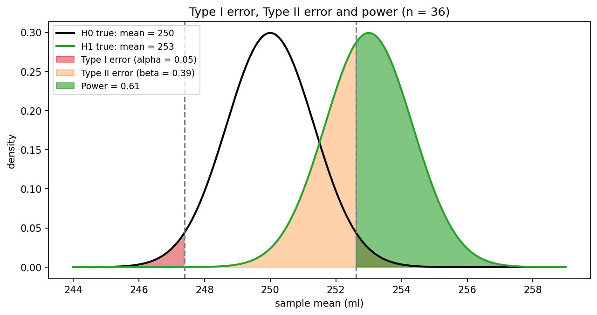

- **Red:** Type I error area, under the $H_0$ curve, in the rejection region. Its total is $\alpha = 0.05$.
- **Orange:** Type II error ($\beta = 0.386$), the part of the 253 curve that falls in the "fail to reject" zone between the dashed lines.
- **Green:** power ($1 - \beta = 0.614$), the part of the 253 curve in the rejection region.

So this experiment has only a **61% chance** of detecting a real 3 ml shift. Nearly 4 times in 10, we'd miss it.

### How sample size changes power

More cups means a smaller standard error, so the two curves above get narrower and separate. For the two-sided z-test, power can be computed directly. With shift $\delta = \mu_1 - \mu_0$ and $z_{c} = 1.96$:

$$\text{power} = P\!\left(Z > z_c - \tfrac{\delta\sqrt{n}}{\sigma}\right) + P\!\left(Z < -z_c - \tfrac{\delta\sqrt{n}}{\sigma}\right).$$

To find the $n$ needed for a target power (ignoring the tiny far-tail term):

$$n \approx \left(\frac{(z_{1-\alpha/2} + z_{\text{power}})\,\sigma}{\delta}\right)^2.$$

For 80% power and $\delta = 3$, $\sigma = 8$: $n \approx \left(\frac{(1.96 + 0.8416) \times 8}{3}\right)^2 \approx 55.8$, so round **up** to $n = 56$.

```python
# 07_power_vs_n.py
import os
import numpy as np
import matplotlib.pyplot as plt
from scipy import stats

os.makedirs("images", exist_ok=True)

def power_z(delta, n, sigma=8, alpha=0.05):
    """Power of a two-sided z-test when the true mean is `delta` above H0's mean."""
    zc = stats.norm.ppf(1 - alpha / 2)
    shift = delta * np.sqrt(n) / sigma
    return stats.norm.sf(zc - shift) + stats.norm.cdf(-zc - shift)

def n_needed(delta, power=0.80, sigma=8, alpha=0.05):
    """Sample size for the desired power (normal approximation)."""
    z_a = stats.norm.ppf(1 - alpha / 2)
    z_b = stats.norm.ppf(power)
    return int(np.ceil(((z_a + z_b) * sigma / delta) ** 2))

# --- Table: power for the 3 ml effect at different sample sizes ---
print("Power to detect a 3 ml difference (sigma = 8, alpha = 0.05):")
for n in [10, 20, 36, 56, 100, 200]:
    print(f"  n = {n:>3}: power = {power_z(3, n):.3f}")

# --- Smaller alpha costs power ---
print("\nEffect of alpha on power (n = 36, delta = 3):")
for a in [0.10, 0.05, 0.01]:
    print(f"  alpha = {a:<4}: power = {power_z(3, 36, alpha=a):.3f}")

# --- Sample size needed for 80% power ---
print("\nSample size needed for 80% power:")
for d in [2, 3, 5]:
    print(f"  true difference = {d} ml: n = {n_needed(d)}")

# --- Check by simulation (fixed seed) ---
rng = np.random.default_rng(1)
reps = 20_000
for n in [36, 56]:
    samples = rng.normal(loc=253, scale=8, size=(reps, n))   # H1 is true: mean is 253
    z = (samples.mean(axis=1) - 250) / (8 / np.sqrt(n))
    rejected = (2 * stats.norm.sf(np.abs(z)) < 0.05).mean()
    print(f"\nSimulated power at n = {n}: {rejected:.3f}  (formula: {power_z(3, n):.3f})")

# --- Plot: power curves ---
ns = np.arange(2, 201)
fig, ax = plt.subplots(figsize=(9, 4.8))
for d, c in zip([2, 3, 5], ["tab:red", "tab:blue", "tab:green"]):
    ax.plot(ns, power_z(d, ns), lw=2.5, color=c, label=f"true difference = {d} ml")
    ax.scatter([n_needed(d)], [0.80], color=c, zorder=5)
ax.axhline(0.80, color="gray", ls="--")
ax.text(150, 0.82, "80% power", color="gray")
ax.axhline(0.05, color="gray", ls=":")
ax.text(150, 0.07, "alpha = 5% (power with no real effect)", color="gray", fontsize=8, ha="center")
ax.set_xlabel("sample size, n")
ax.set_ylabel("power")
ax.set_title("Bigger samples and bigger effects both raise power")
ax.set_ylim(0, 1.02)
ax.legend(loc="lower right")
fig.savefig("../images/06_power_vs_sample_size.png", dpi=150, bbox_inches="tight")
plt.show()
```

Output:

```text
Power to detect a 3 ml difference (sigma = 8, alpha = 0.05):
  n =  10: power = 0.220
  n =  20: power = 0.389
  n =  36: power = 0.614
  n =  56: power = 0.801
  n = 100: power = 0.963
  n = 200: power = 1.000

Effect of alpha on power (n = 36, delta = 3):
  alpha = 0.1 : power = 0.728
  alpha = 0.05: power = 0.614
  alpha = 0.01: power = 0.372

Sample size needed for 80% power:
  true difference = 2 ml: n = 126
  true difference = 3 ml: n = 56
  true difference = 5 ml: n = 21

Simulated power at n = 36: 0.611  (formula: 0.614)

Simulated power at n = 56: 0.805  (formula: 0.801)
```

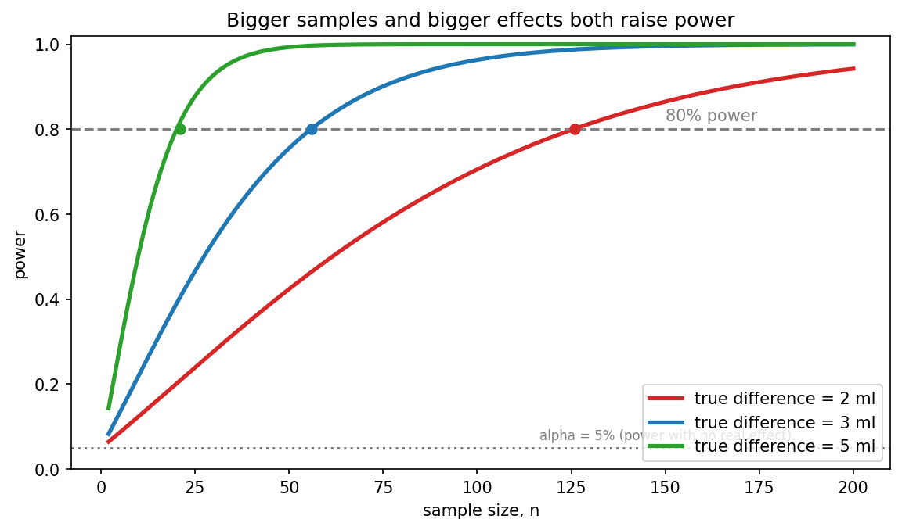

Worked example summary (hypotheses $H_0: \mu = 250$ versus $H_1: \mu \ne 250$, true mean 253, $\alpha = 0.05$):

| Sample size $n$ | Power | Meaning |
|---|---|---|
| 10 | 0.220 | You'd miss the effect about 4 times in 5 |
| 20 | 0.389 | Still more likely to miss than to find it |
| 36 | 0.614 | Better than a coin flip, but not great |
| 56 | 0.801 | The usual 80% target |
| 100 | 0.963 | Almost certain to detect it |

The simulation confirms the formula: at $n = 36$, 20,000 simulated experiments rejected $H_0$ in 61.1% of runs (formula: 61.4%), and at $n = 56$ in 80.5% (formula: 80.1%).

What the table and graph show:

- **Sample size:** power rises from 22% at $n = 10$ to 80% at $n = 56$.
- **Effect size:** a 5 ml shift needs only $n = 21$ for 80% power, while a subtle 2 ml shift needs $n = 126$. Halving the effect roughly quadruples the sample you need, because the standard error shrinks like $1/\sqrt{n}$.
- **$\alpha$:** at $n = 36$ and a 3 ml shift, power is 0.728 at $\alpha = 0.10$, 0.614 at $0.05$, and 0.372 at $0.01$. This is the Type I / Type II trade-off: guarding harder against false alarms means more misses, unless you increase $n$.

### Power and the Bonferroni correction

Bonferroni lowers $\alpha$ per test (e.g. from 0.05 to 0.005), so by the same logic it **lowers power** for each individual test. If you plan to run $m$ tests with a Bonferroni correction, size your study using $\alpha/m$, not $\alpha$. That means a larger sample. This is the price of avoiding false alarms across many tests.

### Why plan power in advance

- An **underpowered** study will often miss real effects, and the effects it *does* flag tend to be exaggerated. "No significant difference" from a small study means very little.
- An **overpowered** study can flag differences too small to matter. Pair p-values with effect sizes and confidence intervals.
- Choosing $n$ in advance (a **power analysis**) is another guard against p-hacking: you don't keep collecting data until the p-value dips below 0.05.

---

## Key takeaways

1. **Null distribution and test statistic:** we know how the test statistic behaves if $H_0$ is true; we ask how surprising our data are under that assumption.
2. **$\alpha$ is a pre-chosen threshold** (commonly 0.05 or 0.01), equal to the Type I error rate you accept. Choose it *before* seeing the data, otherwise you risk p-hacking.
3. **The p-value** is the probability of results at least as extreme as yours, assuming $H_0$ is true. It is also the smallest $\alpha$ at which you'd reject. It is *not* the probability that $H_0$ is true, and it says nothing about the size or importance of an effect.
4. **Confidence interval:** the set of null values you would not reject at the matching level.
5. **The F-test** checks whether *any* regression slope is nonzero ($H_0$: all betas equal zero). Large $F$ (small p-value) means the predictors explain more than luck would.
6. **Multiple testing:** $P(\text{at least one Type I error}) = 1-(1-\alpha)^m$. At $m = 20$ and $\alpha = 0.05$ that is 64%.
7. **Bonferroni:** test each of $m$ hypotheses at $\alpha/m$ to keep the overall false-alarm probability at most $\alpha$. It is simple and safe, but conservative.
8. **Power** $= 1-\beta$ is the probability of detecting a real effect. It rises with larger effects, larger samples, larger $\alpha$, and less noise.
9. **Plan your sample size** (aim for about 80% power) before collecting data, and remember that "not significant" is not the same as "no effect."

------------------------------------------

|  | **MPCoding**<br>*Machine Learning Tutorial Series*<br><br> [](https://www.youtube.com/@MP-Coding) [](https://github.com/madhawapolkotuwa) |
|---|---|

<p align="left" style="font-size: 0.85em; color: gray; margin-top: 10px;">
  © 2026 MPCoding. Educational materials are free to use with proper attribution.
</p>
