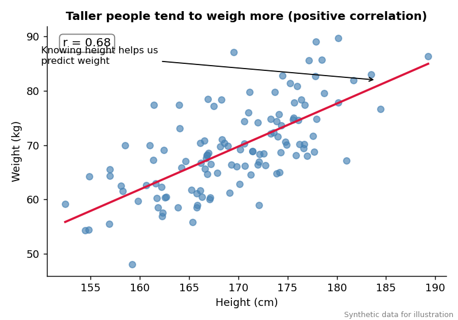
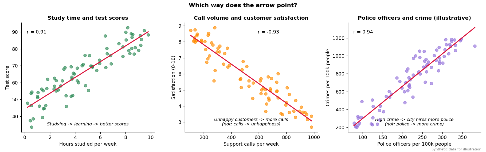
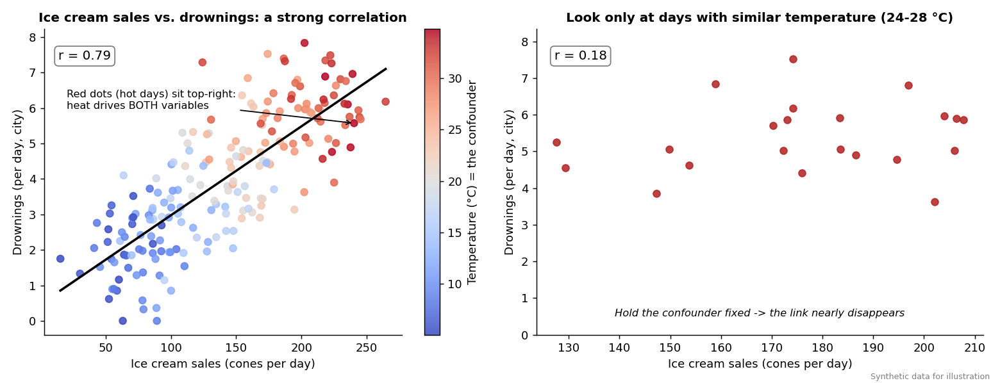
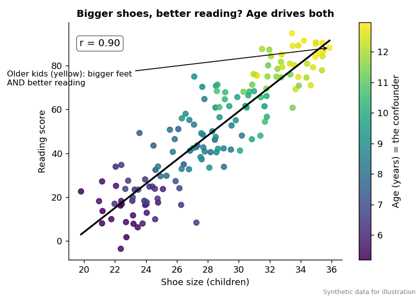
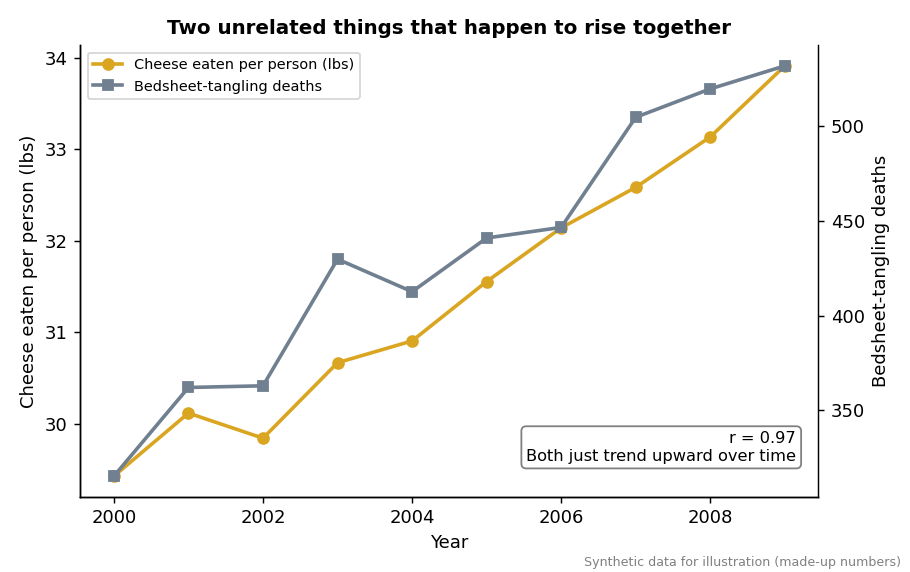
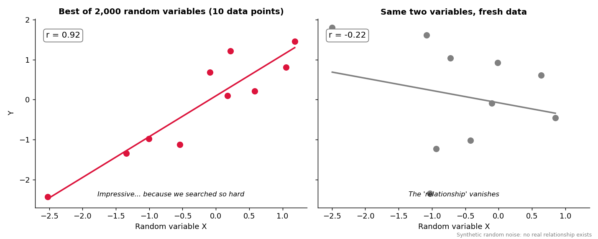

# Correlation vs Causation

- Correlation vs. Causation
- Confounding variables
- Examples of spurious correlations

**Correlation** means two variables tend to move together. A simple example: taller people tend to weigh more. When height goes up, weight usually goes up too. We measure this with a number called **r**, which runs from -1 (perfect opposite movement) to +1 (perfect same-direction movement). Here r is about 0.8, a strong positive correlation.

```python
import os
 
import matplotlib.pyplot as plt
import numpy as np
import pandas as pd

os.makedirs("images", exist_ok=True)
rng = np.random.default_rng(42)  # fixed seed -> same graphs every run
 
plt.rcParams.update({
    "figure.dpi": 130,
    "axes.spines.top": False,
    "axes.spines.right": False,
    "axes.titlesize": 11,
    "axes.titleweight": "bold",
})
NOTE = "Synthetic data for illustration"
 
 
def corr(a, b):
    return np.corrcoef(a, b)[0, 1]
 
 
def trend_line(ax, x, y, color="crimson"):
    m, b = np.polyfit(x, y, 1)
    xs = np.linspace(np.min(x), np.max(x), 50)
    ax.plot(xs, m * xs + b, color=color, lw=2)

# ---------------------------------------------------------------
# 1. A simple correlation: height and weight
# ---------------------------------------------------------------
height = rng.normal(170, 9, 120)
weight = 0.9 * (height - 170) + 70 + rng.normal(0, 6, 120)
 
fig, ax = plt.subplots(figsize=(6, 4.2))
ax.scatter(height, weight, alpha=0.65, color="steelblue")
trend_line(ax, height, weight)
ax.set(title="Taller people tend to weigh more (positive correlation)",
       xlabel="Height (cm)", ylabel="Weight (kg)")
ax.text(0.04, 0.92, f"r = {corr(height, weight):.2f}", transform=ax.transAxes,
        fontsize=11, bbox=dict(boxstyle="round", fc="white", ec="gray"))
ax.annotate("Knowing height helps us\npredict weight", xy=(184, 82), xytext=(150, 85),
            arrowprops=dict(arrowstyle="->"), fontsize=9)
fig.text(0.99, 0.01, NOTE, ha="right", fontsize=7, color="gray")
fig.tight_layout()
fig.savefig("../images/simple_correlation.png")
plt.close(fig)

````



Correlation is useful: if you know someone's height, you can make a decent guess at their weight. But it doesn't tell you that height *causes* weight, or why the two move together. That's what the rest of this page is about.

> All graphs on this page use synthetic (made-up) data for illustration. See [Generating the graphs](#generating-the-graphs) to recreate them.

## How Correlations are important 

If two variables X and Y are correlated, then X is useful for predicting Y.
If we are trying to model Y and find variables that correlate with it, we may improve the model.

We should be careful about changing  X in the hope of changing Y.
X and Y can be correlated for different reasons:
- X causes Y (what we want).
- Y causes X(mixing up cause-and-effect)
- X and Y are both caused by something else (confounding)
- X and Y aren't really related; we just got unlucky in the sample (spurious)

### Mixing Up cause and effect

1. Student test scores are positively correlated with the amount of time studied.

This doesn't mean we should get students to study more by curving everyone's grades upward (this would likely have the opposite effect!). It is more likely that studying helps students learn material, so studying causes better performance.

2. Customer satisfaction is negatively correlated with customer service call volume.

This doesn't mean that we should remove or hide the customer service numbers, with the hope of improving customer satisfaction.

Here the arrow points the other way: unhappy customers call more often. Call volume is a *result* of low satisfaction, not its cause.

3. Cities with more police officers tend to have more crime.

The correlation is real, but it would be a mistake to conclude that police cause crime and we should cut the police force. It is more likely that high-crime cities hire more officers in response. Crime causes police numbers, not the other way around.


```python
# ---------------------------------------------------------------
# 2. Mixing up cause and effect (three examples)
# ---------------------------------------------------------------
fig, axes = plt.subplots(1, 3, figsize=(14, 4.4))
 
# (a) Study time -> test scores (X causes Y)
hours = rng.uniform(0, 10, 80)
score = 45 + 4.5 * hours + rng.normal(0, 6, 80)
ax = axes[0]
ax.scatter(hours, score, alpha=0.65, color="seagreen")
trend_line(ax, hours, score)
ax.set(title="Study time and test scores", xlabel="Hours studied per week",
       ylabel="Test score")
ax.text(0.04, 0.9, f"r = {corr(hours, score):.2f}", transform=ax.transAxes)
ax.text(0.5, 0.06, "Studying -> learning -> better scores",
        transform=ax.transAxes, ha="center", fontsize=9, style="italic")
 
# (b) Call volume vs satisfaction (Y causes X: unhappy customers call more)
calls = rng.uniform(100, 1000, 80)
satisf = 9 - 0.006 * calls + rng.normal(0, 0.6, 80)
ax = axes[1]
ax.scatter(calls, satisf, alpha=0.65, color="darkorange")
trend_line(ax, calls, satisf)
ax.set(title="Call volume and customer satisfaction",
       xlabel="Support calls per week", ylabel="Satisfaction (0-10)")
ax.text(0.55, 0.9, f"r = {corr(calls, satisf):.2f}", transform=ax.transAxes)
ax.text(0.5, 0.06, "Unhappy customers -> more calls\n(not: calls -> unhappiness)",
        transform=ax.transAxes, ha="center", fontsize=9, style="italic")
 
# (c) Police vs crime (Y causes X: high crime -> cities hire more police)
crime = rng.uniform(200, 1200, 80)
police = 0.25 * crime + 40 + rng.normal(0, 25, 80)
ax = axes[2]
ax.scatter(police, crime, alpha=0.65, color="mediumpurple")
trend_line(ax, police, crime)
ax.set(title="Police officers and crime (illustrative)",
       xlabel="Police officers per 100k people", ylabel="Crimes per 100k people")
ax.text(0.04, 0.9, f"r = {corr(police, crime):.2f}", transform=ax.transAxes)
ax.text(0.5, 0.06, "High crime -> city hires more police\n(not: police -> more crime)",
        transform=ax.transAxes, ha="center", fontsize=9, style="italic")
 
fig.suptitle("Which way does the arrow point?", fontweight="bold")
fig.text(0.99, 0.01, NOTE, ha="right", fontsize=7, color="gray")
fig.tight_layout()
fig.savefig("../images/cause_and_effect.png")
plt.show(fig)
```




**A quick check:** when you see X and Y correlated, ask "Could Y be causing X instead?" Timing often helps: the cause usually happens *before* the effect.

### Confounding variables
A confounding variable is something that causes both X and Y to change.
X and Y are correlated even though X doesn't cause Y, and Y doesn't cause X.

**Example: ice cream sales and drownings.** On days when more ice cream is sold, more people drown. The correlation is strong. But ice cream isn't dangerous. Hot weather is the confounder: on hot days people buy more ice cream *and* more people go swimming, so more drownings happen.

- **What the correlation looks like:** a clear upward trend (left graph; the colors show temperature).
- **Why it appears:** temperature drives both variables.
- **The mistake:** banning ice cream to prevent drownings. It would do nothing.

The right graph shows a useful trick: look only at days with *similar* temperatures. Once the confounder is held roughly fixed, the link almost disappears.

```python
# ---------------------------------------------------------------
# 3. Confounder: ice cream sales and drownings (temperature)
# ---------------------------------------------------------------
n = 200
temp = rng.uniform(5, 35, n)                          # the confounder
ice_cream = 20 + 6 * temp + rng.normal(0, 25, n)      # X depends on temp
drown = 0.5 + 0.18 * temp + rng.normal(0, 0.9, n)     # Y depends on temp
drown = np.clip(drown, 0, None)
 
fig, axes = plt.subplots(1, 2, figsize=(12, 4.6))
 
ax = axes[0]
sc = ax.scatter(ice_cream, drown, c=temp, cmap="coolwarm", alpha=0.85)
trend_line(ax, ice_cream, drown, color="black")
ax.set(title="Ice cream sales vs. drownings: a strong correlation",
       xlabel="Ice cream sales (cones per day)", ylabel="Drownings (per day, city)")
ax.text(0.04, 0.9, f"r = {corr(ice_cream, drown):.2f}", transform=ax.transAxes,
        fontsize=11, bbox=dict(boxstyle="round", fc="white", ec="gray"))
fig.colorbar(sc, ax=ax, label="Temperature (°C) = the confounder")
ax.annotate("Red dots (hot days) sit top-right:\nheat drives BOTH variables",
            xy=(ice_cream[np.argmax(temp)], drown[np.argmax(temp)]),
            xytext=(20, 0.5 + 0.7 * drown.max()),
            arrowprops=dict(arrowstyle="->"), fontsize=9)
 
ax = axes[1]
mask = (temp > 24) & (temp < 28)
ax.scatter(ice_cream[mask], drown[mask], color="firebrick", alpha=0.85)
ax.set(title="Look only at days with similar temperature (24-28 °C)",
       xlabel="Ice cream sales (cones per day)", ylabel="Drownings (per day, city)",
       ylim=(0, drown.max() + 0.5))
ax.text(0.04, 0.9, f"r = {corr(ice_cream[mask], drown[mask]):.2f}",
        transform=ax.transAxes, fontsize=11,
        bbox=dict(boxstyle="round", fc="white", ec="gray"))
ax.text(0.5, 0.06, "Hold the confounder fixed -> the link nearly disappears",
        transform=ax.transAxes, ha="center", fontsize=9, style="italic")
 
fig.text(0.99, 0.01, NOTE, ha="right", fontsize=7, color="gray")
fig.tight_layout()
fig.savefig("images/confounder_ice_cream.png")
plt.show(fig)
```



**Example: shoe size and reading ability in children.** Kids with bigger feet read better. Does buying bigger shoes improve reading? No. Age is the confounder: older children have bigger feet *and* have had more time to learn to read.

```python
# ---------------------------------------------------------------
# 4. Confounder: shoe size and reading ability (age)
# ---------------------------------------------------------------
n = 150
age = rng.uniform(5, 13, n)
shoe = 14 + 1.6 * age + rng.normal(0, 1.2, n)          # EU-ish kids' shoe size
reading = 10 * (age - 4) + rng.normal(0, 8, n)         # reading score
 
fig, ax = plt.subplots(figsize=(6.5, 4.6))
sc = ax.scatter(shoe, reading, c=age, cmap="viridis", alpha=0.85)
trend_line(ax, shoe, reading, color="black")
ax.set(title="Bigger shoes, better reading? Age drives both",
       xlabel="Shoe size (children)", ylabel="Reading score")
fig.colorbar(sc, ax=ax, label="Age (years) = the confounder")
ax.text(0.04, 0.9, f"r = {corr(shoe, reading):.2f}", transform=ax.transAxes,
        fontsize=11, bbox=dict(boxstyle="round", fc="white", ec="gray"))
ax.annotate("Older kids (yellow): bigger feet\nAND better reading",
            xy=(shoe[np.argmax(age)], reading[np.argmax(age)]),
            xytext=(15, 0.75 * reading.max()),
            arrowprops=dict(arrowstyle="->"), fontsize=9)
fig.text(0.99, 0.01, NOTE, ha="right", fontsize=7, color="gray")
fig.tight_layout()
fig.savefig("../images/confounder_shoe_size.png")
plt.show(fig)
```



Another everyday one: sunburn and ice cream sales. Sunny weather causes both.

### Spurious Correlations.
 These are correlations that are just "coincidences" due to the particular sample, and would probably not hold on longer samples / different samples.

They tend to show up for three reasons:

- **Shared trends over time.** Many things simply rise (or fall) over the years. Any two of them will look correlated, even if they have nothing to do with each other.
- **Many variables tested.** If you compare enough pairs, some will line up by pure luck.
- **Small samples.** With only a few data points, chance patterns look much stronger than they really are.

**Example: cheese eaten and bedsheet accidents (shared trend).** Websites of "funny correlations" famously pair things like per-person cheese consumption with deaths by tangled bedsheets. Both numbers happened to climb over the same years, so r is very high. (The numbers in the graph below are made up, but the pattern is the real one.)

- **What the correlation looks like:** two lines rising together.
- **Why it appears:** both just trend upward with time; there's no link between them.
- **The mistake:** thinking that eating less cheese would prevent bedsheet accidents.

```python
# ---------------------------------------------------------------
# 5. Spurious: two unrelated series that both trend upward
# ---------------------------------------------------------------
years = np.arange(2000, 2010)
cheese = 29 + 0.55 * (years - 2000) + rng.normal(0, 0.25, len(years))
bedsheet = 330 + 22 * (years - 2000) + rng.normal(0, 12, len(years))
 
fig, ax1 = plt.subplots(figsize=(7, 4.4))
ax2 = ax1.twinx()
ax2.spines["right"].set_visible(True)
l1, = ax1.plot(years, cheese, "o-", color="goldenrod", lw=2,
               label="Cheese eaten per person (lbs)")
l2, = ax2.plot(years, bedsheet, "s-", color="slategray", lw=2,
               label="Bedsheet-tangling deaths")
ax1.set(xlabel="Year", ylabel="Cheese eaten per person (lbs)",
        title="Two unrelated things that happen to rise together")
ax2.set_ylabel("Bedsheet-tangling deaths")
ax1.legend(handles=[l1, l2], loc="upper left", fontsize=8)
ax1.text(0.97, 0.08, f"r = {corr(cheese, bedsheet):.2f}\nBoth just trend upward over time",
         transform=ax1.transAxes, ha="right", fontsize=9,
         bbox=dict(boxstyle="round", fc="white", ec="gray"))
fig.text(0.99, 0.01, NOTE + " (made-up numbers)", ha="right", fontsize=7, color="gray")
fig.tight_layout()
fig.savefig("../images/spurious_time_series.png")
plt.show(fig)
```



**Example: searching through many variables (many tests + small sample).** The graph below uses pure random noise. We generated 2,000 random variables with only 10 data points each, then picked the one that best matches our target. It looks impressive (left). But when we try the same two variables on fresh data, the "relationship" is gone (right).

- **What the correlation looks like:** a strong, convincing trend.
- **Why it appears:** with enough tries and few data points, luck produces strong-looking patterns.
- **The mistake:** treating the winner as a real relationship and using it to make predictions. It won't hold up on new data.

```python
# ---------------------------------------------------------------
# 6. Spurious: test lots of variables, small sample, then check new data
# ---------------------------------------------------------------
n_points, n_vars = 10, 2000
target = rng.normal(size=n_points)
candidates = pd.DataFrame(rng.normal(size=(n_points, n_vars)))   # pure noise
rs = candidates.apply(lambda col: corr(col, target))
best = rs.abs().idxmax()
 
new_target = rng.normal(size=n_points)               # brand-new sample
new_best = rng.normal(size=n_points)                 # same two variables, new data
 
fig, axes = plt.subplots(1, 2, figsize=(11, 4.4), sharey=True, sharex=True)
ax = axes[0]
ax.scatter(candidates[best], target, color="crimson", s=55)
trend_line(ax, candidates[best], target)
ax.set(title=f"Best of {n_vars:,} random variables (10 data points)",
       xlabel="Random variable X", ylabel="Y")
ax.text(0.04, 0.9, f"r = {corr(candidates[best], target):.2f}",
        transform=ax.transAxes, fontsize=11,
        bbox=dict(boxstyle="round", fc="white", ec="gray"))
ax.text(0.5, 0.06, "Impressive... because we searched so hard",
        transform=ax.transAxes, ha="center", fontsize=9, style="italic")
 
ax = axes[1]
ax.scatter(new_best, new_target, color="gray", s=55)
trend_line(ax, new_best, new_target, color="gray")
ax.set(title="Same two variables, fresh data", xlabel="Random variable X")
ax.text(0.04, 0.9, f"r = {corr(new_best, new_target):.2f}",
        transform=ax.transAxes, fontsize=11,
        bbox=dict(boxstyle="round", fc="white", ec="gray"))
ax.text(0.5, 0.06, "The 'relationship' vanishes",
        transform=ax.transAxes, ha="center", fontsize=9, style="italic")
 
fig.text(0.99, 0.01, "Synthetic random noise: no real relationship exists",
         ha="right", fontsize=7, color="gray")
fig.tight_layout()
fig.savefig("../images/spurious_many_variables.png")
plt.show(fig)
```



**How to protect yourself:** use larger samples, test your finding on new data, and ask whether there's a plausible reason the two things would be connected.
